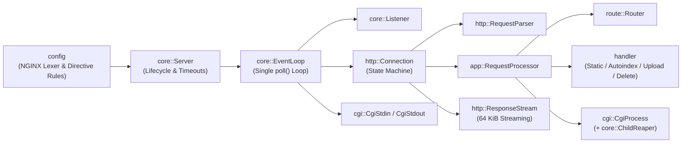

*This project has been created as part of the 42 curriculum by yoshin, jyoo.*

<div align="center">
  
  <h1>webserv</h1>
  <p>HTTP/1.1 &amp; CGI/1.1 server written in C++98 with a single-process <code>poll()</code> event loop</p>
  <p>
    <a href="https://github.com/42GS/webserv/actions/workflows/ci.yml"></a>
    
    
    
  </p>
  <p>
    <a href="README.md">한국어</a> | <strong>English</strong>
  </p>
  <p>
    <a href="docs/architecture.en.md">Architecture &amp; Design Notes</a> ·
    <a href="docs/configuration.en.md">Configuration Reference</a> ·
    <a href="CHANGELOG.en.md">Changelog &amp; Releases</a>
  </p>
</div>

---

## Description

`webserv` is an HTTP/1.1 server written in C++98 with no external libraries.
One process serves every listening socket, client socket, and CGI pipe from a single `poll()` loop. All sockets and pipes are non-blocking, and each readiness event performs at most one `recv()` or `send()`.

The project covers both web backend work and systems programming. On the HTTP side, it handles request parsing, routing, file uploads and deletion, and CGI scripts. On the systems side, it manages the event loop, socket lifecycles, non-blocking pipe I/O, child process reaping, timeouts, and memory safety.

### Main Features

| Area | What it does |
| :--- | :--- |
| **Event Loop &amp; Connections** | Single `poll()` loop (`EventLoop`), connection state machine (`Connection`), `keep-alive`, pipelining, per-state timeouts |
| **HTTP/1.1 Request Parsing** | Incremental parser (`RequestParser`) for split TCP reads, `Content-Length` and `Transfer-Encoding: chunked`, line/header/body limits (`413`, `414`, `431`) |
| **Routing &amp; Configuration** | NGINX-style config (`server`, `location`, `root`, `alias`, `index`, `autoindex`, `return`, `error_page`, `limit_except`, `client_max_body_size`) |
| **Static Files &amp; Uploads** | Static files (files over `1 MiB` streamed in `64 KiB` pieces), directory listings, `multipart/form-data` uploads (`201`/`409`), `DELETE` (`204`) |
| **CGI/1.1** | Extension-based CGI (`fork`/`execve`), RFC 3875 meta-variables, non-blocking pipes, `10s` timeout (`504`), `502` on broken scripts |
| **Security &amp; Operations** | Path traversal rejection (`400`), `httpoxy` (`CVE-2016-5385`) and `_` header filtering, `logs/access.log` &amp; `logs/error.log`, clean `SIGINT`/`SIGTERM` shutdown |

### Overview



For the connection state machine (`READ_HEAD → READ_BODY → WAIT_CGI → WRITE → DRAIN → CLOSED`), timeout values, and module breakdown, see [docs/architecture.en.md](docs/architecture.en.md).

### Notes on Key Design Choices

* **Getting the Time Without Time Functions (`Clock`):** The allowed function list has no time functions like `time()` or `gettimeofday()`. So on each `poll()` iteration, `Clock` rewrites `.webserv_clock` and reads its modification time with `stat()`. That drives timeouts and the `Date` header.
* **Avoiding TCP RST on Early Errors (`DRAIN`):** If the server sends an error like `413` before reading the full request body and closes the socket right away, unread bytes in the kernel buffer can trigger a TCP `RST` and wipe out the response at the client. The `DRAIN` state reads and discards incoming bytes briefly before closing.
* **Stopping CPU Spin When FDs Run Out:** If `accept()` fails because the file descriptor table is full, `Listener` pauses polling instead of spinning on every loop pass. It resumes when a connection closes or one second passes.
* **CGI Security &amp; Output Caps:** `CgiEnv` drops `Proxy` (to prevent `httpoxy`, `CVE-2016-5385`) and headers containing `_` (matching NGINX defaults). CGI output is capped at `16 MiB` (`502` if exceeded) and handed off via `std::string::swap` without copying.

### Release Milestones

Commits are grouped into semantic tags from `v0.1.0` to `v1.0.0`. Full notes are in [CHANGELOG.en.md](CHANGELOG.en.md).

| Tag | Commit | Summary |
| :--- | :--- | :--- |
| `v0.1.0` | `6f48721` | Single `poll()` loop, NGINX-style config parser, unit and integration test harnesses |
| `v0.2.0` | `7404b94` | Incremental HTTP/1.1 parser, path normalization, router, static file streaming and listings |
| `v0.3.0` | `870f06a` | Keep-alive, pipelining, `DRAIN` state, and per-state timeouts |
| `v0.4.0` | `3385e7e` | `multipart/form-data` uploads, `DELETE`, and upload file count limits |
| `v0.5.0` | `1655980` | Non-blocking CGI/1.1 pipes, `502`/`504` handling, `ChildReaper` |
| `v0.6.0` | `6b4ffc2` | Listener pause/resume on FD exhaustion, zero-copy CGI handoff, Valgrind and Electric Fence checks |
| `v1.0.0` | `4db9510` | Access/error logs, `httpoxy` filtering, C++ standard portability, Linux &amp; macOS release binaries |

---

## Instructions

### Build &amp; Test

```sh
make              # Build ./webserv (c++ -Wall -Wextra -Werror -std=c++98)
make test         # Build and run C++98 unit tests (./run_tests)
make integration  # Run Python 3 stdlib TCP integration tests
make format       # Format source files with clang-format (.clang-format)
make clean        # Remove object/dependency files
make fclean       # Remove build artifacts and binaries
```

* **Unit Tests (`tests/unit/`):** Uses a small C++98 test framework ([TestFramework.hpp](tests/unit/TestFramework.hpp)) and `EventLoop` test doubles. **105/105 tests pass** under `make test`.
* **Integration Tests (`tests/integration/`):** 11 Python `unittest` suites (124 test cases) that start the server and talk to it over TCP. `WEBSERV_SLOW_TESTS=1` includes timeout tests, and `WEBSERV_WRAPPER="valgrind --error-exitcode=99 --leak-check=full"` checks clean exits under Valgrind.
* **Stress Test:** `siege -b -c 50 -t 1M http://127.0.0.1:8080/empty.html`.

### Run

Run from the repository root so relative paths in the demo configs (`www/`, `logs/`, `conf/`) resolve correctly. Make sure `logs/` exists, and stop the server with `Ctrl-C` (`SIGINT`/`SIGTERM`) to close sockets and clean up CGI children.

```sh
./webserv [configuration file]   # default: conf/default.conf
```

* CGI demos require `/usr/bin/python3`; the PHP demo (`/cgi-bin/hello.php`) needs `/usr/bin/php-cgi`.
* Logs are appended to `logs/access.log` and `logs/error.log` (`tail -f logs/*.log`).
* `.webserv_clock` is created and updated in the working directory.

### Demo Configurations &amp; Endpoints

See [docs/configuration.en.md](docs/configuration.en.md) for all 12 directives and routing rules.

| File | What it shows |
| :--- | :--- |
| [conf/default.conf](conf/default.conf) | Full demo on `127.0.0.1:8080` (`www/`) and a second site on `127.0.0.1:8081` (`www2/`) |
| [conf/ports.conf](conf/ports.conf) | Multiple interfaces and ports (`127.0.0.2` requires Linux or a macOS `lo0` alias) |
| [conf/same-port.conf](conf/same-port.conf) | Duplicate `interface:port` rejection on startup (virtual hosts are not implemented) |

<details>
<summary><strong>Browser Demo &amp; curl Commands (Click to expand)</strong></summary>

With `./webserv conf/default.conf`, open `http://127.0.0.1:8080/` in a browser or run:

```sh
# Static files, autoindex, alias, redirect, error handling
curl -i http://127.0.0.1:8080/                      # static site
curl -i http://127.0.0.1:8080/files/                # directory listing (autoindex)
curl -i http://127.0.0.1:8080/docs/                 # alias route with its index
curl -i http://127.0.0.1:8080/old/                  # 301 redirect
curl -i http://127.0.0.1:8080/nothing               # custom 404 page
curl -i -X DELETE http://127.0.0.1:8080/index.html  # 405: not allowed here
curl -i -X UNKNOWN http://127.0.0.1:8080/           # 501, no crash

# Body size limit (64 bytes on /limit/)
curl -i -X POST -H "Content-Type: plain/text" --data "BODY IS HERE" \
     http://127.0.0.1:8080/limit/echo.py
curl -i -X POST -H "Content-Type: plain/text" \
     --data "BODY IS HERE write something longer than the body limit of 64 bytes" \
     http://127.0.0.1:8080/limit/echo.py            # 413 Payload Too Large

# Multipart upload (201), download (200), duplicate conflict (409), delete (204)
curl -i -F "file=@README.md" http://127.0.0.1:8080/upload/
curl -i http://127.0.0.1:8080/upload/README.md
curl -i -X DELETE http://127.0.0.1:8080/upload/README.md

# CGI (GET query, POST form, chunked body, relative path, 502, 504 timeout, PHP, cookie session)
curl -i "http://127.0.0.1:8080/cgi-bin/hello.py?name=you"
curl -i -X POST --data "name=a&message=b" http://127.0.0.1:8080/cgi-bin/form.py
curl -i -H "Transfer-Encoding: chunked" --data "chunked body" \
     http://127.0.0.1:8080/cgi-bin/form.py
curl -i http://127.0.0.1:8080/cgi-bin/relative.py   # runs in script's own directory
curl -i http://127.0.0.1:8080/cgi-bin/error.py      # 502 Bad Gateway
curl -i http://127.0.0.1:8080/cgi-bin/loop.py       # 504 Gateway Timeout (10 s)
curl -i http://127.0.0.1:8080/cgi-bin/hello.php     # bonus: second CGI
curl -i -c jar -b jar http://127.0.0.1:8080/cgi-bin/session.py

# Stress test on an empty page
siege -b -c 50 -t 1M http://127.0.0.1:8080/empty.html
```

</details>

### Project Structure

```text
.
├── .github/workflows/         # GitHub Actions CI & release binary workflows
├── conf/                      # NGINX-style configuration files
├── docs/                      # Architecture & configuration docs (KO / EN .en.md)
├── CHANGELOG.md / .en.md      # Release notes (KO / EN)
├── README.md / README.en.md   # Project overview (KO / EN)
├── include/ & src/
│   ├── core/                  # EventLoop (poll), Server, Listener, Clock, ChildReaper, Signals, Logger
│   ├── config/                # ConfigLexer, ConfigSyntax, DirectiveRules, Builders
│   ├── http/                  # Connection FSM, RequestParser, ResponseStream, Multipart, MimeTypes
│   ├── route/                 # Router, PathResolver
│   ├── handler/               # StaticHandler, AutoindexHandler, UploadHandler, DeleteHandler, StatusPage
│   ├── cgi/                   # CgiProcess, CgiPipes, CgiEnv, CgiOutput
│   ├── fs/                    # FileInfo, FilePath, FileReader, FileWriter
│   └── app/                   # RequestProcessor, ProcessOutcome, ConnectionServices
├── tests/
│   ├── unit/                  # 17 C++98 unit test suites (105 test cases)
│   └── integration/           # 11 Python TCP integration test suites (124 test cases)
└── www/ & www2/               # Interactive browser demo & CGI scripts
```

---

## Resources

* **RFCs:** RFC 9110 (HTTP Semantics), RFC 9112 (HTTP/1.1), RFC 3986 (URI), RFC 3875 (CGI 1.1), RFC 7578 &amp; RFC 2046 (`multipart/form-data`), RFC 6265 (Cookies), RFC 1945 (HTTP/1.0).
* **NGINX Documentation:** core, rewrite, index, and autoindex modules.
* **POSIX.1-2024:** `poll`, `recv`, `send`, `bind`, `fcntl`, `waitpid`, `_Exit`, `remove`, `rmdir`, `<signal.h>`.
* **PHP Manual &amp; `php-cgi` source:** `cgi.force_redirect` and `REDIRECT_STATUS`.
* **Tools &amp; Style:** `siege` manual, Valgrind, Electric Fence, C++ Core Guidelines, Google C++ Style Guide (`.clang-format`).

### Use of AI

We used Claude Code (Anthropic) throughout the project, and reviewed and tested everything it produced:

* **Research:** Summarizing the specs above and running small experiments on macOS and Ubuntu 22.04 where the docs did not settle a question (such as `poll()` bits on closed pipes or closing after a `413`).
* **Design:** Reviewing structural options and making our own calls on the rules (`400` for `..` above root, multipart-only uploads, `GET`/`HEAD` default when `limit_except` is omitted).
* **Code &amp; Refactoring:** Writing the C++ code step by step, reviewing each piece, and cleaning up modules after reviews (splitting files, removing copies and out-parameters).
* **Tests:** Writing the unit tests and Python integration tests, and checking stability with `valgrind`, Electric Fence, and `siege`.
