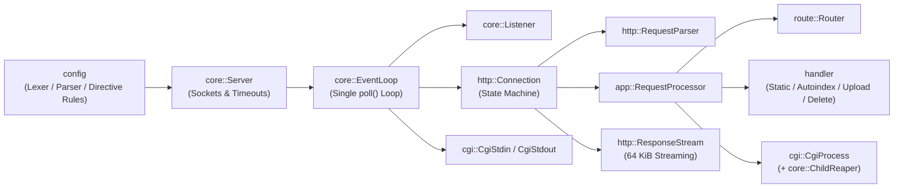

*This project has been created as part of the 42 curriculum by yoshin, jyoo.*

<div align="center">
  
  <h1>webserv</h1>
  <p>HTTP/1.1 &amp; CGI/1.1 server written in C++98 with a single-process <code>poll()</code> loop</p>
  <p>
    <a href="https://github.com/42GS/webserv/actions/workflows/ci.yml"></a>
    
    
    
  </p>
  <p><a href="README.md">한국어</a> | <strong>English</strong></p>
</div>

---

## Description

An HTTP/1.1 web server built from scratch in **C++98** using only POSIX system calls and no external libraries.
One process handles listening sockets, client connections, and CGI pipes in a single `poll()` loop. All sockets and pipes are non-blocking, and each readiness event triggers at most one `recv()` or `send()`.

### Project Summary

| Item | Details |
| :--- | :--- |
| Timeline / Team | Oct 16 – Oct 29, 2026 / 2-person team (`yoshin`, `jyoo`) |
| Stack | C++98 (`-Wall -Wextra -Werror`), POSIX Sockets, `poll()`, CGI/1.1 (`fork`/`execve`) |
| Architecture | Single-process non-blocking event loop, connection state machine, 8-layer module split |
| Verification | `105/105` C++98 unit tests passing, 11 Python TCP integration suites (124 cases), checked with Valgrind, Electric Fence &amp; `siege` |
| Releases / CI | GitHub Actions CI, Linux (`x86_64`) &amp; macOS (`arm64`) release binaries ([v1.0.0](https://github.com/42GS/webserv/releases/tag/v1.0.0)) |
| Docs | [Architecture Notes](docs/architecture.en.md) · [Configuration Reference](docs/configuration.en.md) · [Changelog](CHANGELOG.en.md) |

### Key Implementation

* **Event Loop &amp; Connections**
  * One `poll()` loop (`EventLoop`) handles listening sockets, client sockets, and CGI pipe I/O.
  * Supports `keep-alive`, HTTP pipelining, and per-state timeouts (idle, header, body, send, drain).
* **HTTP/1.1 Parsing &amp; Routing**
  * Incremental parser (`RequestParser`) handles split TCP reads, `Content-Length`, and `Transfer-Encoding: chunked`.
  * NGINX-style configuration (`server`, `location`, `root`, `alias`, `index`, `autoindex`, `return`, `error_page`, `limit_except`, `client_max_body_size`).
* **Files &amp; CGI/1.1**
  * Serves static files (files over `1 MiB` are streamed in `64 KiB` pieces) and HTML directory listings.
  * Handles `multipart/form-data` uploads (`201`/`409`) and `DELETE` (`204`).
  * Runs CGI scripts by file extension (`fork`/`execve`), passes RFC 3875 meta-variables, polls pipes non-blockingly, enforces a `10s` timeout (`504`), and collects children via `ChildReaper`.
* **Security &amp; Operations**
  * Rejects path traversal (`..` above root returns `400`) and bounds request line (`414`), header (`431`), and body (`413`) sizes.
  * Writes `logs/access.log` and `logs/error.log`, and cleans up active sockets and CGI children on `SIGINT`/`SIGTERM`.

### Architecture



See [docs/architecture.en.md](docs/architecture.en.md) for the connection state machine (`READ_HEAD → READ_BODY → WAIT_CGI → WRITE → DRAIN → CLOSED`), timeout constants, and deferred removal (`unwatched_`).

### Engineering Problems Solved

* **Wall-clock time without time calls (`Clock`)**: The subject forbids `time()` and `gettimeofday()`. `Clock` rewrites `.webserv_clock` once per `poll()` pass and reads `st_mtime` with `stat()` for timeouts and `Date` headers.
* **Avoiding TCP RST on early errors (`DRAIN`)**: Closing the socket immediately after sending `413` while request bytes remain in the kernel buffer can trigger a TCP `RST` and drop the response at the client. `DRAIN` briefly reads and discards remaining bytes before closing.
* **Stopping CPU spin on FD exhaustion**: When `accept()` fails because the FD table is full, `Listener` pauses polling and resumes on connection close or every 1 second rather than spinning at 100% CPU.
* **CGI security and copy avoidance**: `CgiEnv` drops `Proxy` (`httpoxy`, `CVE-2016-5385`) and header names with `_`. Output is capped at `16 MiB` and returned via `std::string::swap` without copying.

### Releases

| Tag | Commit | Summary |
| :--- | :--- | :--- |
| `v0.1.0` | `6f48721` | `poll()` event loop, NGINX config parser, unit &amp; integration test harnesses |
| `v0.2.0` | `7404b94` | Incremental HTTP/1.1 parser, path normalization, router, static streaming &amp; autoindex |
| `v0.3.0` | `870f06a` | Keep-alive, pipelining, `DRAIN` state, per-state timeouts |
| `v0.4.0` | `3385e7e` | `multipart/form-data` uploads, `DELETE`, upload file count cap |
| `v0.5.0` | `1655980` | Non-blocking CGI/1.1 pipes, `502`/`504` handling, `ChildReaper` |
| `v0.6.0` | `6b4ffc2` | Listener pause/resume on FD exhaustion, zero-copy CGI output, Valgrind &amp; Electric Fence checks |
| `v1.0.0` | `4db9510` | Access/error logs, `httpoxy` filtering, C++ standard portability, Linux/macOS release binaries |

> Full changelog: [CHANGELOG.en.md](CHANGELOG.en.md)

---

## Instructions

### Build &amp; Test

```sh
make              # Build ./webserv (-Wall -Wextra -Werror -std=c++98)
make test         # Run C++98 unit tests (105/105 passing)
make integration  # Run Python 3 TCP integration tests (11 suites / 124 cases)
make format       # Format source files with clang-format
make clean        # Remove object files
make fclean       # Remove all build artifacts
```

* `WEBSERV_SLOW_TESTS=1 make integration`: includes timeout and full-build checks.
* `WEBSERV_WRAPPER="valgrind --error-exitcode=99 --leak-check=full" make integration`: checks clean exits and zero leaks under Valgrind.
* `siege -b -c 50 -t 1M http://127.0.0.1:8080/empty.html`: stress test.

### Run

Run from the repository root (`conf/`, `www/`, `logs/` are relative to it). Stop with `Ctrl-C`.

```sh
./webserv [configuration file]   # default: conf/default.conf
```

* Pre-built `tar.gz` bundles (Linux `x86_64` / macOS `arm64`) are also available on [Releases](https://github.com/42GS/webserv/releases/tag/v1.0.0).
* CGI demos need `/usr/bin/python3`; the PHP demo needs `/usr/bin/php-cgi`.
* Watch logs with `tail -f logs/*.log` (`logs/access.log`, `logs/error.log`).

### Configuration &amp; Demo

See [docs/configuration.en.md](docs/configuration.en.md) for all 12 directives and routing rules.

| File | Purpose |
| :--- | :--- |
| [conf/default.conf](conf/default.conf) | Main demo on `127.0.0.1:8080` (`www/`) + second site on `127.0.0.1:8081` (`www2/`) |
| [conf/ports.conf](conf/ports.conf) | Multi-interface &amp; multi-port binding (`127.0.0.2` needs Linux or macOS `lo0` alias) |
| [conf/same-port.conf](conf/same-port.conf) | Rejects duplicate `interface:port` on startup (virtual hosts not implemented) |

<details>
<summary><strong>curl Demo Commands (Click to expand)</strong></summary>

With `./webserv conf/default.conf`, open `http://127.0.0.1:8080/` in a browser or run:

```sh
# Static files, autoindex, alias, redirect, error handling
curl -i http://127.0.0.1:8080/
curl -i http://127.0.0.1:8080/files/
curl -i http://127.0.0.1:8080/docs/
curl -i http://127.0.0.1:8080/old/                  # 301
curl -i http://127.0.0.1:8080/nothing               # custom 404
curl -i -X DELETE http://127.0.0.1:8080/index.html  # 405
curl -i -X UNKNOWN http://127.0.0.1:8080/           # 501

# Body size limit (64 bytes on /limit/)
curl -i -X POST -H "Content-Type: plain/text" --data "BODY IS HERE" \
     http://127.0.0.1:8080/limit/echo.py
curl -i -X POST -H "Content-Type: plain/text" \
     --data "BODY IS HERE write something longer than the body limit of 64 bytes" \
     http://127.0.0.1:8080/limit/echo.py            # 413

# Upload (201), download (200), conflict (409), delete (204)
curl -i -F "file=@README.md" http://127.0.0.1:8080/upload/
curl -i http://127.0.0.1:8080/upload/README.md
curl -i -X DELETE http://127.0.0.1:8080/upload/README.md

# CGI (GET, POST, chunked, relative path, 502, 504 timeout, PHP, cookie session)
curl -i "http://127.0.0.1:8080/cgi-bin/hello.py?name=you"
curl -i -X POST --data "name=a&message=b" http://127.0.0.1:8080/cgi-bin/form.py
curl -i -H "Transfer-Encoding: chunked" --data "chunked body" \
     http://127.0.0.1:8080/cgi-bin/form.py
curl -i http://127.0.0.1:8080/cgi-bin/relative.py
curl -i http://127.0.0.1:8080/cgi-bin/error.py      # 502
curl -i http://127.0.0.1:8080/cgi-bin/loop.py       # 504 (10s)
curl -i http://127.0.0.1:8080/cgi-bin/hello.php
curl -i -c jar -b jar http://127.0.0.1:8080/cgi-bin/session.py
```

</details>

### Project Structure

```text
.
├── .github/workflows/         # CI and multi-platform binary release workflows
├── conf/                      # NGINX-style configuration presets
├── docs/                      # Architecture & configuration docs (KO / EN .en.md)
├── CHANGELOG.md / .en.md      # Release notes (KO / EN)
├── README.md / README.en.md   # Project overview (KO / EN)
├── include/ & src/
│   ├── core/                  # EventLoop, Server, Listener, Clock, ChildReaper, Signals, Logger
│   ├── config/                # ConfigLexer, ConfigSyntax, DirectiveRules, Builders
│   ├── http/                  # Connection FSM, RequestParser, ResponseStream, Multipart, MimeTypes
│   ├── route/                 # Router, PathResolver
│   ├── handler/               # StaticHandler, AutoindexHandler, UploadHandler, DeleteHandler, StatusPage
│   ├── cgi/                   # CgiProcess, CgiPipes, CgiEnv, CgiOutput
│   ├── fs/                    # FileInfo, FilePath, FileReader, FileWriter
│   └── app/                   # RequestProcessor, ProcessOutcome, ConnectionServices
├── tests/
│   ├── unit/                  # C++98 unit tests (17 files / 105 cases)
│   └── integration/           # Python TCP integration tests (11 files / 124 cases)
└── www/ & www2/               # Browser demo & CGI scripts
```

---

## Resources

* **RFCs**: RFC 9110, RFC 9112 (HTTP/1.1), RFC 3986 (URI), RFC 3875 (CGI 1.1), RFC 7578 &amp; RFC 2046 (`multipart/form-data`), RFC 6265 (Cookies), RFC 1945
* **NGINX**: core, rewrite, index, and autoindex module docs
* **POSIX.1-2024**: `poll`, `recv`, `send`, `bind`, `fcntl`, `waitpid`, `_Exit`, `remove`, `rmdir`, `<signal.h>`
* **PHP / Tools**: `php-cgi` (`REDIRECT_STATUS`), `siege`, Valgrind, Electric Fence, Google C++ Style Guide (`.clang-format`)

### Use of AI

We used Claude Code (Anthropic) as an assistant throughout the project, while owning all design choices, reviews, and verification:

* Summarized RFC and POSIX specs and ran small OS experiments (closed-pipe `poll()` bits, `413` close behavior) on macOS and Ubuntu 22.04.
* Reviewed structural proposals and decided core rules ourselves (`400` on `..` above root, multipart-only uploads, `GET`/`HEAD` default for `limit_except`).
* Wrote and refactored C++ modules incrementally, reviewing each change to remove copies and out-parameters.
* Co-authored unit and integration tests and verified stability with `valgrind`, Electric Fence, and `siege`.
