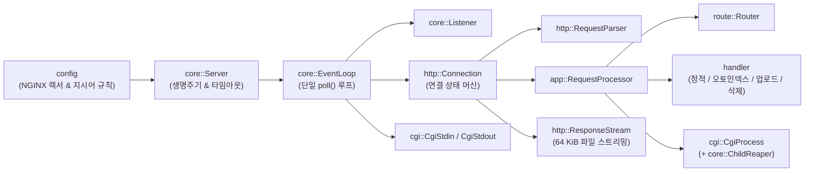

*This project has been created as part of the 42 curriculum by yoshin, jyoo.*

<div align="center">
  
  <h1>webserv</h1>
  <p>
    <strong>C++98 기반 단일 프로세스 <code>poll()</code> 이벤트 루프 · 논블로킹 I/O · HTTP/1.1 &amp; CGI/1.1 웹 서버</strong>
  </p>
  <p>
    <a href="https://github.com/42GS/webserv/actions/workflows/ci.yml"></a>
    
    
    
  </p>
  <p>
    <a href="README.md">English</a> | <strong>한국어</strong>
  </p>
  <p>
    <a href="docs/architecture.ko.md">아키텍처 및 설계 의사결정</a> ·
    <a href="docs/configuration.ko.md">설정 파일 레퍼런스</a> ·
    <a href="CHANGELOG.ko.md">릴리스 노트</a>
  </p>
</div>

---

## 개요

**webserv**는 외부 라이브러리 없이 **C++98**로 바닥부터 구현한 **RFC 9112 준수 HTTP/1.1 웹 서버**입니다. 단일 프로세스 내 하나의 `poll()` 이벤트 루프가 모든 리스닝 소켓, 클라이언트 연결, CGI 파이프를 다중화하며, 각 준비 이벤트당 최대 한 번의 논블로킹 `recv()`, `send()` 또는 파이프 I/O만 수행합니다.

### 핵심 엔지니어링 포인트

**백엔드(프로토콜 준수·라우팅·CGI·업로드)** 및 **시스템·네트워크(이벤트 다중화·POSIX IPC·장애 격리·메모리 안정성)** 직무 관점 모두에서 설계 근거를 확인할 수 있도록 구성했습니다.

| 영역 | 백엔드 엔지니어링 관점 | 시스템·네트워크 엔지니어링 관점 |
| :--- | :--- | :--- |
| **코어 I/O 및 동시성** | 연결 유지(`keep-alive`), HTTP 파이프라이닝, 청크(`chunked`) 본문 디코딩 | 단일 `poll()` 루프(`EventLoop`), 지연 핸들러 제거(`unwatched_`), FD 고갈 시 `Listener` 일시 정지/재개 |
| **프로토콜 및 파싱** | RFC 9112 증분 파서, `HEAD`/`GET`/`POST`/`DELETE`, MIME 타입, IMF-fixdate `Date` 헤더 | 커서 기반 무복사 버퍼 소비, 2단계 본문 상한 적용(`HEAD_DONE`), TCP `RST` 방지용 `DRAIN` 상태(RFC 9112 §9.6) |
| **라우팅 및 설정** | NGINX 스타일 설정(`server`, `location`, `root`/`alias`, `return`, `autoindex`, `error_page`, `limit_except`) | 테이블 기반 `DirectiveRules`, 최장 접두사 매칭, `alias` 세그먼트 경계 검증, 경로 탈출 차단(`400`) |
| **CGI 및 업로드** | CGI/1.1(`fork`/`execve`), `multipart/form-data` 업로드(`201`/`409`), 쿠키/세션 데모 | 논블로킹 CGI 파이프(`CgiPipes`), `waitpid(WNOHANG)` 좀비 회수, `std::string::swap` 무복사 전달, `httpoxy`(`CVE-2016-5385`) 방어 |
| **안정성 및 운영** | `logs/access.log` 및 `logs/error.log` 기록, 위치별 `client_max_body_size`(`1B–100MiB`) | 상태별 세분화 타임아웃(Slowloris/전송 정체 방어), 연결 단위 예외 격리, `SIGINT`/`SIGTERM` 정상 종료, `stat()` 기반 `Clock` |

### 아키텍처 개요



> 연결 상태 머신(`READ_HEAD → READ_BODY → WAIT_CGI → WRITE → DRAIN → CLOSED`), 상태별 타임아웃 상수, `.webserv_clock` 설계 배경 등 상세 기술 문서: **[docs/architecture.ko.md](docs/architecture.ko.md)**

### 주요 설계 및 보안 결정

* **시간 함수 제약 극복 (`core::Clock`):** 과제 제약상 표준 시간 함수(`time()`, `gettimeofday()`)를 사용할 수 없어, `EventLoop` 반복마다 `.webserv_clock` 파일을 갱신하고 허용 시스템 콜인 `stat()`으로 수정 시각(`st_mtime`)을 읽어 타임아웃과 RFC 9110 `Date` 헤더를 구동합니다.
* **대용량 파일 청크 스트리밍 (`ResponseStream`):** `1 MiB` 이하 파일은 메모리로 읽고, 초과 파일은 `POLLOUT` 이벤트마다 `64 KiB`씩 스트리밍해 단일 스레드 이벤트 루프가 블로킹되지 않도록 설계했습니다.
* **CGI 보안 및 리소스 상한:** `CgiEnv`에서 `Proxy` 헤더(`CVE-2016-5385` httpoxy)와 밑줄(`_`) 포함 헤더(헤더 스푸핑 방지)를 차단하고, 실행 시간(`10 s`, 초과 시 `504`) 및 출력 크기(`16 MiB`, 초과 시 `502`) 상한을 강제하며 `ChildReaper`로 모든 자식 프로세스를 회수합니다.
* **업로드 DoS 방어:** `UploadHandler`는 슬라이스 오프셋 기반 선형 시간 파싱으로 대용량 페이로드 복사를 제거하고, 요청당 업로드 파일 수를 `5`개로 제한(초과 시 `413`)해 이벤트 루프 정체를 방지합니다.

### 릴리스 마일스톤

커밋 히스토리를 기반으로 재구성한 시맨틱 버전(`v0.1.0` – `v1.0.0`)입니다. 전체 변경 이력은 **[CHANGELOG.ko.md](CHANGELOG.ko.md)** 에서 확인할 수 있습니다.

| Tag | Commit | 요약 |
| :--- | :--- | :--- |
| `v0.1.0` | `6f48721` | 단일 `poll()` 이벤트 루프, NGINX 스타일 설정 파서, 단위/통합 테스트 하네스 구축 |
| `v0.2.0` | `7404b94` | 증분 HTTP/1.1 파서, 경로 정규화 및 라우터, 정적 파일 스트리밍 및 디렉토리 목록 |
| `v0.3.0` | `870f06a` | Keep-Alive, 파이프라이닝, `DRAIN` 상태, 상태별 타임아웃 구현 |
| `v0.4.0` | `3385e7e` | `multipart/form-data` 업로드, `DELETE`, 업로드 파일 수/크기 제한 |
| `v0.5.0` | `1655980` | 비동기 CGI/1.1 파이프 실행, `502`/`504` 처리, `ChildReaper` |
| `v0.6.0` | `6b4ffc2` | FD 고갈 시 리스너 일시 정지/재개, CGI 출력 무복사 전달, Valgrind 및 Electric Fence 검증 |
| `v1.0.0` | `4db9510` | 접근/오류 로그, `httpoxy` 및 헤더 스푸핑 차단, 최신 C++ 표준 호환성, 릴리스 바이너리 배포 |

---

## 빌드 및 실행 방법

### 빌드 및 테스트

```sh
make              # ./webserv 빌드 (c++ -Wall -Wextra -Werror -std=c++98)
make test         # C++98 단위 테스트 빌드 및 실행 (./run_tests)
make integration  # Python 3 표준 라이브러리 기반 TCP 통합 테스트 실행
make format       # clang-format으로 코드 포맷 정리 (.clang-format)
make clean        # 오브젝트 및 의존성 파일 삭제
make fclean       # 빌드 산출물 및 실행 바이너리 삭제
```

#### 검증 범위
* **단위 테스트 (`tests/unit/`):** 자체 C++98 테스트 프레임워크([TestFramework.hpp](tests/unit/TestFramework.hpp))와 `EventLoop` 테스트 더블 활용 — **105/105 통과** (`make test`).
* **통합 테스트 (`tests/integration/`):** 빌드, HTTP 파싱, Keep-Alive/파이프라이닝, 정적/오토인덱스, 업로드, CGI, 로깅, 타임아웃(`WEBSERV_SLOW_TESTS=1`), Valgrind 누수 검증(`WEBSERV_WRAPPER="valgrind --error-exitcode=99 --leak-check=full"`)을 포함한 **11개 스위트(124개 테스트 케이스)**.
* **부하 테스트:** `siege -b -c 50 -t 1M http://127.0.0.1:8080/empty.html` 지원.

### 실행

데모 설정 내 상대 경로(`www/`, `logs/`, `conf/`)가 올바르게 해석되도록 저장소 루트에서 실행하세요. 종료 시 `Ctrl-C`(`SIGINT`/`SIGTERM`)를 보내면 활성 소켓과 CGI 자식 프로세스를 안전하게 정리한 뒤 종료합니다.

```sh
./webserv [설정 파일 경로]   # 기본값: conf/default.conf
```

* CGI 데모 실행에는 `/usr/bin/python3`가, PHP 보너스 엔드포인트(`/cgi-bin/hello.php`)에는 `/usr/bin/php-cgi`가 필요합니다.
* 접근/오류 로그는 `logs/access.log` 및 `logs/error.log`에 기록됩니다 (`tail -f logs/*.log`).
* 실행 디렉터리에 `stat()` 기반 시각 추적용 `.webserv_clock` 파일이 생성/갱신됩니다.

### 데모 설정 및 테스트 명령

전체 12개 지시어 문법 및 라우팅 우선순위는 **[docs/configuration.ko.md](docs/configuration.ko.md)** 를 참고하세요.

| 파일 | 설명 |
| :--- | :--- |
| [conf/default.conf](conf/default.conf) | `127.0.0.1:8080`(`www/`) 메인 데모 및 `127.0.0.1:8081`(`www2/`) 보조 사이트 |
| [conf/ports.conf](conf/ports.conf) | 다중 인터페이스 및 포트 바인딩 (`127.0.0.2`는 Linux 또는 macOS `lo0` 별칭 필요) |
| [conf/same-port.conf](conf/same-port.conf) | 중복 `interface:port` 거부 확인용 (가상 호스트 미지원) |

<details>
<summary><strong>브라우저 데모 및 curl 테스트 명령 (클릭하여 펼치기)</strong></summary>

`./webserv conf/default.conf` 실행 후 브라우저에서 `http://127.0.0.1:8080/`을 열거나 아래 명령을 실행합니다.

```sh
# 정적 파일, 디렉토리 목록, alias, 리다이렉트, 오류 처리
curl -i http://127.0.0.1:8080/                      # 정적 사이트
curl -i http://127.0.0.1:8080/files/                # 디렉토리 목록 (autoindex)
curl -i http://127.0.0.1:8080/docs/                 # alias 경로 및 인덱스 파일
curl -i http://127.0.0.1:8080/old/                  # 301 리다이렉트
curl -i http://127.0.0.1:8080/nothing               # 커스텀 404 페이지
curl -i -X DELETE http://127.0.0.1:8080/index.html  # 405 Method Not Allowed
curl -i -X UNKNOWN http://127.0.0.1:8080/           # 501 Not Implemented

# 본문 크기 제한 (/limit/ 경로 64바이트 제한)
curl -i -X POST -H "Content-Type: plain/text" --data "BODY IS HERE" \
     http://127.0.0.1:8080/limit/echo.py
curl -i -X POST -H "Content-Type: plain/text" \
     --data "BODY IS HERE write something longer than the body limit of 64 bytes" \
     http://127.0.0.1:8080/limit/echo.py            # 413 Payload Too Large

# 멀티파트 업로드 (201), 다운로드 (200), 중복 파일 충돌 (409), 삭제 (204)
curl -i -F "file=@README.md" http://127.0.0.1:8080/upload/
curl -i http://127.0.0.1:8080/upload/README.md
curl -i -X DELETE http://127.0.0.1:8080/upload/README.md

# CGI (GET 쿼리, POST 폼, 청크 본문, 상대 경로, 502, 504 타임아웃, PHP, 쿠키 세션)
curl -i "http://127.0.0.1:8080/cgi-bin/hello.py?name=you"
curl -i -X POST --data "name=a&message=b" http://127.0.0.1:8080/cgi-bin/form.py
curl -i -H "Transfer-Encoding: chunked" --data "chunked body" \
     http://127.0.0.1:8080/cgi-bin/form.py
curl -i http://127.0.0.1:8080/cgi-bin/relative.py   # 스크립트 디렉터리 기준으로 실행
curl -i http://127.0.0.1:8080/cgi-bin/error.py      # 502 Bad Gateway
curl -i http://127.0.0.1:8080/cgi-bin/loop.py       # 504 Gateway Timeout (10초)
curl -i http://127.0.0.1:8080/cgi-bin/hello.php     # 보너스: PHP CGI
curl -i -c jar -b jar http://127.0.0.1:8080/cgi-bin/session.py

# siege 부하 테스트
siege -b -c 50 -t 1M http://127.0.0.1:8080/empty.html
```

</details>

### 프로젝트 구조

```text
.
├── .github/workflows/         # GitHub Actions CI 및 멀티플랫폼 바이너리 릴리스 워크플로우
├── conf/                      # NGINX 스타일 설정 프리셋
├── docs/                      # 아키텍처 및 설정 상세 문서 (영문/국문)
├── CHANGELOG.md / .ko.md      # 릴리스 노트 (영문/국문)
├── README.md / README.ko.md   # 프로젝트 개요 (영문/국문)
├── include/ & src/
│   ├── core/                  # EventLoop (poll), Server, Listener, Clock, ChildReaper, Signals, Logger
│   ├── config/                # ConfigLexer, ConfigSyntax, DirectiveRules, Builders
│   ├── http/                  # Connection FSM, RequestParser, ResponseStream, Multipart, MimeTypes
│   ├── route/                 # Router, PathResolver (경로 정규화 및 탈출 방어)
│   ├── handler/               # StaticHandler, AutoindexHandler, UploadHandler, DeleteHandler, StatusPage
│   ├── cgi/                   # CgiProcess, CgiPipes, CgiEnv, CgiOutput
│   ├── fs/                    # FileInfo, FilePath, FileReader, FileWriter
│   └── app/                   # RequestProcessor, ProcessOutcome, ConnectionServices
├── tests/
│   ├── unit/                  # C++98 단위 테스트 17개 스위트 (105개 케이스)
│   └── integration/           # Python TCP 통합 테스트 11개 스위트 (124개 케이스)
└── www/ & www2/               # 브라우저 데모 사이트 및 CGI 스크립트
```

---

## 참고 자료

* **IETF RFCs:** RFC 9110 (HTTP Semantics), RFC 9112 (HTTP/1.1), RFC 3986 (URI), RFC 3875 (CGI 1.1), RFC 7578 &amp; RFC 2046 (`multipart/form-data`), RFC 6265 (Cookies), RFC 1945 (HTTP/1.0).
* **NGINX 문서:** Core, rewrite, index, autoindex 모듈의 설정 문법 및 라우팅 동작 참고.
* **POSIX.1-2024:** `poll`, `recv`, `send`, `bind`, `fcntl`, `waitpid`, `_Exit`, `remove`, `rmdir`, `<signal.h>`.
* **PHP 매뉴얼 및 `php-cgi` 소스:** `cgi.force_redirect` 및 `REDIRECT_STATUS` 요구사항.
* **도구 및 스타일 가이드:** `siege` 매뉴얼, Valgrind, Electric Fence, C++ Core Guidelines, Google C++ Style Guide (`.clang-format`).

### AI 활용 내역

프로젝트 전반에서 **Claude Code (Anthropic)**를 보조 도구로 활용했으며, 모든 아키텍처 의사결정, 보안 리뷰, 최종 검증은 작성자가 직접 수행했습니다.

* **리서치 및 OS 실험:** RFC/POSIX 스펙 요약 및 명세가 불명확한 동작(예: 닫힌 파이프의 `poll()` 이벤트 비트, `413` 응답 후 소켓 drain 동작)에 대한 macOS/Ubuntu 22.04 실험 수행.
* **설계 주도권:** 구조 제안 비교 후 핵심 설계 결정(루트 이탈 시 `400`, multipart 전용 업로드, `limit_except` 미지정 시 `GET`/`HEAD` 제한, `.webserv_clock` 격리)을 직접 확정.
* **점진적 구현 및 리팩토링:** 단계별 코드 리뷰를 거치며 복사 제거, 출력 인자 제거, 모듈 분리를 수행.
* **검증:** 단위·통합 테스트 공동 작성 및 `valgrind`, Electric Fence, `siege` 기반 독립 안정성 검증.
