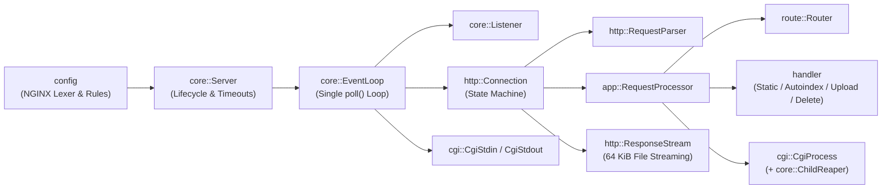

*This project has been created as part of the 42 curriculum by yoshin, jyoo.*

<div align="center">
  
  <h1>webserv</h1>
  <p>
    <strong>RFC 9112-compliant HTTP/1.1 Server in C++98 — Single-Process <code>poll()</code> Event Loop, Non-Blocking I/O &amp; CGI/1.1</strong>
  </p>
  <p>
    <a href="https://github.com/42GS/webserv/actions/workflows/ci.yml"></a>
    
    
    
  </p>
  <p>
    <strong>English</strong> | <a href="README.ko.md">한국어</a>
  </p>
  <p>
    <a href="docs/architecture.md">Architecture &amp; Design</a> ·
    <a href="docs/configuration.md">Configuration Reference</a> ·
    <a href="CHANGELOG.md">Changelog &amp; Releases</a>
  </p>
</div>

---

## Description

**webserv** is an HTTP/1.1 web server built from scratch in **C++98 with zero external dependencies**. A single OS process multiplexes every listening socket, client connection, and CGI pipe through one `poll()` event loop—performing at most one non-blocking `recv()`, `send()`, or pipe I/O per readiness event.

### Engineering Highlights

Designed and documented to demonstrate both **Backend Engineering** (protocol compliance, routing, CGI, uploads) and **Systems/Network Engineering** (event multiplexing, POSIX IPC, fault isolation, memory safety):

| Domain | Backend Engineering | Systems &amp; Network Engineering |
| :--- | :--- | :--- |
| **Core I/O &amp; Concurrency** | Persistent connections (`keep-alive`), HTTP pipelining, chunked transfer decoding | Single `poll()` loop (`EventLoop`), deferred handler removal (`unwatched_`), FD-exhaustion backpressure (`Listener` pause/resume) |
| **Protocol &amp; Parsing** | RFC 9112 incremental parser, `HEAD`/`GET`/`POST`/`DELETE`, MIME types, IMF-fixdate `Date` | Cursor-based zero-shift buffering, two-phase body limit (`HEAD_DONE`), `DRAIN` state (RFC 9112 §9.6) to prevent TCP `RST` |
| **Routing &amp; Config** | NGINX-style config (`server`, `location`, `root`/`alias`, `return`, `autoindex`, `error_page`, `limit_except`) | Table-driven `DirectiveRules`, longest-prefix matching, segment-boundary `alias` checks, path traversal rejection (`400`) |
| **CGI &amp; Uploads** | CGI/1.1 (`fork`/`execve`), `multipart/form-data` upload (`201`/`409`), cookie/session demo | Non-blocking CGI pipes (`CgiPipes`), `waitpid(WNOHANG)` zombie reaper, `std::string::swap` zero-copy output, `httpoxy` (`CVE-2016-5385`) mitigation |
| **Resilience &amp; Ops** | Structured `logs/access.log` &amp; `logs/error.log`, configurable `client_max_body_size` (`1B–100MiB`) | Per-state timeouts (Slowloris/stall defense), per-connection exception isolation, clean `SIGINT`/`SIGTERM` shutdown, `stat()`-based `Clock` |

### Architecture Overview



> Deep dive into the connection state machine (`READ_HEAD → READ_BODY → WAIT_CGI → WRITE → DRAIN → CLOSED`), timeout constants, and design trade-offs: **[docs/architecture.md](docs/architecture.md)**

### Key Design &amp; Security Decisions

* **Wall-Clock Time Without Time Functions (`core::Clock`):** Because standard time functions (`time()`, `gettimeofday()`) are outside the allowed function list, `Clock` rewrites `.webserv_clock` once per `poll()` iteration and reads `st_mtime` via `stat()`, driving all timeouts and RFC 9110 `Date` headers cleanly behind a single interface.
* **Streaming Large Files (`ResponseStream`):** Files up to `1 MiB` are served from memory; larger files are streamed in `64 KiB` chunks per `POLLOUT` event so large transfers never block the single-threaded loop.
* **CGI Security &amp; Resource Bounds:** `CgiEnv` strips `Proxy` (`CVE-2016-5385` httpoxy) and underscore (`_`) header names (NGINX convention against header spoofing), enforces a `10 s` execution timeout (`504`) and `16 MiB` output cap (`502`), and reaps every child via `ChildReaper`.
* **Upload DoS Defense:** `UploadHandler` parses `multipart/form-data` in linear time using slice offsets (zero payload copies) and caps uploaded files per request (`5` files max, `413` if exceeded) to prevent event-loop stalls.

### Release Milestones

Reconstructed from the commit history into semantic tags (`v0.1.0` – `v1.0.0`) — see **[CHANGELOG.md](CHANGELOG.md)** for full release notes:

| Tag | Commit | Summary |
| :--- | :--- | :--- |
| `v0.1.0` | `6f48721` | Core `poll()` event loop, NGINX-style config parser, unit &amp; integration harnesses |
| `v0.2.0` | `7404b94` | Incremental HTTP/1.1 parser, path normalization, router, static streaming &amp; autoindex |
| `v0.3.0` | `870f06a` | Keep-alive, pipelining, `DRAIN` state, and per-state timeouts |
| `v0.4.0` | `3385e7e` | `multipart/form-data` uploads, `DELETE`, and upload bounds |
| `v0.5.0` | `1655980` | Asynchronous CGI/1.1 pipes, `502`/`504` handling, `ChildReaper` |
| `v0.6.0` | `6b4ffc2` | FD-exhaustion pause/resume, zero-copy CGI output, Valgrind &amp; Electric Fence audit |
| `v1.0.0` | `4db9510` | Access/error logging, `httpoxy` &amp; header-spoofing fixes, standard C++ portability, release binaries |

---

## Instructions

### Build &amp; Test

```sh
make              # Build ./webserv (c++ -Wall -Wextra -Werror -std=c++98)
make test         # Build and run C++98 unit tests (./run_tests)
make integration  # Run Python 3 stdlib TCP integration test suites
make format       # Format source files with clang-format (.clang-format)
make clean        # Remove object/dependency files
make fclean       # Remove build artifacts and binaries
```

#### Verification Scope
* **Unit Tests (`tests/unit/`):** Custom C++98 test framework ([TestFramework.hpp](tests/unit/TestFramework.hpp)) with `EventLoop` test doubles — **105/105 tests passing** (`make test`).
* **Integration Tests (`tests/integration/`):** 11 Python `unittest` suites (124 test cases) covering builds, HTTP parsing, keep-alive/pipelining, static/autoindex, uploads, CGI, logging, timeouts (`WEBSERV_SLOW_TESTS=1`), and Valgrind clean-exit checks (`WEBSERV_WRAPPER="valgrind --error-exitcode=99 --leak-check=full"`).
* **Stress Benchmark:** Supports `siege -b -c 50 -t 1M http://127.0.0.1:8080/empty.html`.

### Run

Run from the repository root so relative paths in the demo configs (`www/`, `logs/`, `conf/`) resolve properly. Ensure `logs/` exists (present in the repo) and stop with `Ctrl-C` (`SIGINT`/`SIGTERM`) to drain/close active sockets and terminate CGI child processes cleanly.

```sh
./webserv [configuration file]   # default: conf/default.conf
```

* CGI demos require `/usr/bin/python3`; the PHP bonus endpoint (`/cgi-bin/hello.php`) requires `/usr/bin/php-cgi`.
* Logs are written to `logs/access.log` and `logs/error.log` (`tail -f logs/*.log`).
* `.webserv_clock` is created/updated in the working directory for `stat()`-based time tracking.

### Demo Configurations &amp; Endpoints

See **[docs/configuration.md](docs/configuration.md)** for the full directive reference (`12` directives) and routing rules.

| File | What it demonstrates |
| :--- | :--- |
| [conf/default.conf](conf/default.conf) | Full demo on `127.0.0.1:8080` (`www/`) and a second server on `127.0.0.1:8081` (`www2/`) |
| [conf/ports.conf](conf/ports.conf) | Multi-interface &amp; multi-port listeners (`127.0.0.2` requires Linux or macOS `lo0` alias) |
| [conf/same-port.conf](conf/same-port.conf) | Duplicate `interface:port` rejection (virtual hosts intentionally unsupported) |

<details>
<summary><strong>Interactive Browser Demo &amp; curl Commands (Click to expand)</strong></summary>

With `./webserv conf/default.conf`, open `http://127.0.0.1:8080/` in your browser or run:

```sh
# Static files, autoindex, alias, redirect, error handling
curl -i http://127.0.0.1:8080/                      # static site
curl -i http://127.0.0.1:8080/files/                # directory listing (autoindex)
curl -i http://127.0.0.1:8080/docs/                 # alias route with its index
curl -i http://127.0.0.1:8080/old/                  # 301 redirect
curl -i http://127.0.0.1:8080/nothing               # custom 404 page
curl -i -X DELETE http://127.0.0.1:8080/index.html  # 405: not allowed here
curl -i -X UNKNOWN http://127.0.0.1:8080/           # 501, no crash

# Body size limit (64 bytes on /limit/)
curl -i -X POST -H "Content-Type: plain/text" --data "BODY IS HERE" \
     http://127.0.0.1:8080/limit/echo.py
curl -i -X POST -H "Content-Type: plain/text" \
     --data "BODY IS HERE write something longer than the body limit of 64 bytes" \
     http://127.0.0.1:8080/limit/echo.py            # 413 Payload Too Large

# Multipart upload (201), download (200), duplicate conflict (409), delete (204)
curl -i -F "file=@README.md" http://127.0.0.1:8080/upload/
curl -i http://127.0.0.1:8080/upload/README.md
curl -i -X DELETE http://127.0.0.1:8080/upload/README.md

# CGI (GET query, POST form, chunked body, relative path, 502, 504 timeout, PHP, cookie session)
curl -i "http://127.0.0.1:8080/cgi-bin/hello.py?name=you"
curl -i -X POST --data "name=a&message=b" http://127.0.0.1:8080/cgi-bin/form.py
curl -i -H "Transfer-Encoding: chunked" --data "chunked body" \
     http://127.0.0.1:8080/cgi-bin/form.py
curl -i http://127.0.0.1:8080/cgi-bin/relative.py   # runs in script's own directory
curl -i http://127.0.0.1:8080/cgi-bin/error.py      # 502 Bad Gateway
curl -i http://127.0.0.1:8080/cgi-bin/loop.py       # 504 Gateway Timeout (10 s)
curl -i http://127.0.0.1:8080/cgi-bin/hello.php     # bonus: second CGI
curl -i -c jar -b jar http://127.0.0.1:8080/cgi-bin/session.py

# Stress test on an empty page
siege -b -c 50 -t 1M http://127.0.0.1:8080/empty.html
```

</details>

### Project Structure

```text
.
├── .github/workflows/         # GitHub Actions CI & release binary workflows
├── conf/                      # NGINX-style configuration presets
├── docs/                      # Architecture & configuration docs (EN / KO)
├── CHANGELOG.md / .ko.md      # Release notes (EN / KO)
├── README.md / README.ko.md   # Project overview (EN / KO)
├── include/ & src/
│   ├── core/                  # EventLoop (poll), Server, Listener, Clock, ChildReaper, Signals, Logger
│   ├── config/                # ConfigLexer, ConfigSyntax, DirectiveRules, Builders
│   ├── http/                  # Connection FSM, RequestParser, ResponseStream, Multipart, MimeTypes
│   ├── route/                 # Router, PathResolver (normalization & traversal defense)
│   ├── handler/               # StaticHandler, AutoindexHandler, UploadHandler, DeleteHandler, StatusPage
│   ├── cgi/                   # CgiProcess, CgiPipes, CgiEnv, CgiOutput
│   ├── fs/                    # FileInfo, FilePath, FileReader, FileWriter
│   └── app/                   # RequestProcessor, ProcessOutcome, ConnectionServices
├── tests/
│   ├── unit/                  # 17 C++98 unit test suites (105 test cases)
│   └── integration/           # 11 Python TCP integration test suites (124 test cases)
└── www/ & www2/               # Interactive browser demo & CGI scripts
```

---

## Resources

* **IETF RFCs:** RFC 9110 (HTTP Semantics), RFC 9112 (HTTP/1.1), RFC 3986 (URI), RFC 3875 (CGI 1.1), RFC 7578 &amp; RFC 2046 (`multipart/form-data`), RFC 6265 (Cookies), RFC 1945 (HTTP/1.0).
* **NGINX Documentation:** Core, rewrite, index, and autoindex module semantics used as configuration and routing behavior references.
* **POSIX.1-2024:** `poll`, `recv`, `send`, `bind`, `fcntl`, `waitpid`, `_Exit`, `remove`, `rmdir`, `<signal.h>`.
* **PHP Manual &amp; `php-cgi` source:** `cgi.force_redirect` / `REDIRECT_STATUS` requirements.
* **Tooling &amp; Style:** `siege` manual, Valgrind, Electric Fence, C++ Core Guidelines, Google C++ Style Guide (`.clang-format`).

### Use of AI

We used **Claude Code (Anthropic)** as an engineering assistant throughout the project, with all architecture decisions, security reviews, and verification owned and executed by the authors:

* **Research &amp; Edge-case Experiments:** Summarized RFCs/POSIX specs into reference notes and ran targeted OS experiments (macOS &amp; Ubuntu 22.04) for underspecified behaviors (e.g., `poll()` events on half-closed pipes, draining before closing after `413`).
* **Design Ownership:** Evaluated structural proposals while retaining explicit human control over key decisions (`400` on `..` above root, multipart-only uploads, `GET`/`HEAD` default under `limit_except`, `.webserv_clock` isolation).
* **Iterative Implementation &amp; Refactoring:** Built and refactored modules incrementally (removing copies and out-parameters, splitting responsibilities) with human code review at each step.
* **Verification:** Co-authored unit and integration tests and independently validated stability using `valgrind`, Electric Fence, and `siege`.
