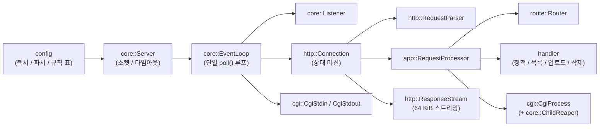

*This project has been created as part of the 42 curriculum by yoshin, jyoo.*

<div align="center">
  
  <h1>webserv</h1>
  <p>C++98 기반 단일 프로세스 <code>poll()</code> HTTP/1.1 &amp; CGI/1.1 웹 서버</p>
  <p>
    <a href="https://github.com/42GS/webserv/actions/workflows/ci.yml"></a>
    
    
    
  </p>
  <p><strong>한국어</strong> | <a href="README.en.md">English</a></p>
</div>

---

## Description

외부 라이브러리 없이 **C++98**과 POSIX 시스템 콜만으로 구현한 **HTTP/1.1 웹 서버**다.
단일 프로세스 내 하나의 `poll()` 루프로 리스닝 소켓, 클라이언트 연결, CGI 파이프를 모두 다중화한다.

### 프로젝트 요약

| 항목 | 내용 |
| :--- | :--- |
| **개발 기간 / 인원** | 2026.10.16 – 2026.10.29 / 2인 팀 프로젝트 (`yoshin`, `jyoo`) |
| **기술 스택** | C++98 (`-Wall -Wextra -Werror`), POSIX Sockets, `poll()`, CGI/1.1 (`fork`/`execve`) |
| **핵심 구조** | 단일 프로세스 논블로킹 이벤트 루프, 연결 상태 머신, 8계층 모듈 분리 |
| **품질 검증** | C++98 단위 테스트 `105/105` 통과, Python TCP 통합 테스트 11개 스위트(124케이스), Valgrind·Electric Fence·`siege` 확인 |
| **배포 / CI** | GitHub Actions CI, Linux(`x86_64`)·macOS(`arm64`) 릴리스 바이너리 제공 ([v1.0.0](https://github.com/42GS/webserv/releases/tag/v1.0.0)) |
| **상세 문서** | [아키텍처 메모](docs/architecture.md) · [설정 레퍼런스](docs/configuration.md) · [릴리스 노트](CHANGELOG.md) |

### 핵심 구현 내용

* **이벤트 루프 및 연결 관리**
  * 단일 `poll()` 루프(`EventLoop`)에서 모든 소켓과 CGI 파이프 I/O 처리 (준비 이벤트당 1회 `recv()`/`send()`)
  * `keep-alive`, HTTP 파이프라이닝, 상태별 타임아웃(유휴/헤더/본문/전송/드레인) 적용
* **HTTP/1.1 파싱 및 라우팅**
  * TCP 패킷 분할을 처리하는 증분 파서(`RequestParser`), `Content-Length` 및 `Transfer-Encoding: chunked` 지원
  * NGINX 스타일 설정(`server`, `location`, `root`, `alias`, `index`, `autoindex`, `return`, `error_page`, `limit_except`, `client_max_body_size`)
* **파일 처리 및 CGI/1.1**
  * 정적 파일 서빙(`1 MiB` 초과 파일은 `64 KiB` 청크 스트리밍), 디렉터리 목록 생성
  * `multipart/form-data` 파일 업로드(`201`/`409`) 및 `DELETE`(`204`)
  * 확장자 기반 CGI 실행, RFC 3875 메타변수 전달, 논블로킹 파이프 I/O, `10초` 타임아웃(`504`) 및 `ChildReaper` 좀비 회수
* **보안 및 운영**
  * 경로 탈출(`..`) 차단(`400`), 요청 줄·헤더·본문 크기 상한 검사(`414`, `431`, `413`)
  * `logs/access.log`·`logs/error.log` 기록, `SIGINT`/`SIGTERM` 수신 시 활성 소켓·CGI 자식 정리 종료

### 아키텍처



* 연결 상태 전이(`READ_HEAD → READ_BODY → WAIT_CGI → WRITE → DRAIN → CLOSED`), 타임아웃 상수, 지연 핸들러 제거(`unwatched_`) 설명은 [docs/architecture.md](docs/architecture.md) 참고.

### 주요 문제 해결 사례

* **시간 함수 제약 우회 (`Clock`):** `time()`·`gettimeofday()` 사용이 금지된 환경에서 `poll()` 1회전마다 `.webserv_clock`을 갱신하고 `stat()`의 `st_mtime`을 읽어 타임아웃과 `Date` 헤더 구현.
* **조기 오류 응답 시 TCP RST 방지 (`DRAIN`):** 본문 수신 중 `413` 등을 반환하고 소켓을 바로 닫으면 커널 버퍼 잔여 바이트 때문에 `RST`가 발생해 응답이 유실될 수 있음 → `DRAIN` 상태로 잔여 입력을 잠시 폐기한 뒤 정상 종료.
* **FD 고갈 시 CPU 스핀 차단:** `accept()` 실패 시 `Listener` 폴링을 일시 정지하고, 연결 종료 또는 1초 틱마다 재개해 루프의 100% CPU 점유 방지.
* **CGI 보안 및 메모리 복사 최적화:** `CgiEnv`에서 `Proxy` 헤더(`httpoxy`, `CVE-2016-5385`)와 `_` 포함 헤더 차단. CGI 출력은 `16 MiB`로 제한하고 `std::string::swap`으로 무복사 반환.

### 릴리스 이력

| Tag | Commit | 주요 변경 사항 |
| :--- | :--- | :--- |
| `v0.1.0` | `6f48721` | `poll()` 이벤트 루프, NGINX 설정 파서, 단위·통합 테스트 하네스 |
| `v0.2.0` | `7404b94` | 증분 HTTP/1.1 파서, 경로 정규화, 라우터, 정적 파일 스트리밍·오토인덱스 |
| `v0.3.0` | `870f06a` | keep-alive, 파이프라이닝, `DRAIN` 상태, 상태별 타임아웃 |
| `v0.4.0` | `3385e7e` | `multipart/form-data` 업로드, `DELETE`, 요청당 업로드 파일 수 제한 |
| `v0.5.0` | `1655980` | 비동기 CGI/1.1 파이프 실행, `502`/`504` 처리, `ChildReaper` |
| `v0.6.0` | `6b4ffc2` | FD 고갈 리스너 일시 정지, CGI 출력 무복사 전달, Valgrind·Electric Fence 검증 |
| `v1.0.0` | `4db9510` | 접근/오류 로그, `httpoxy` 차단, C++ 표준 호환성, Linux/macOS 릴리스 바이너리 |

> 상세 변경 이력: [CHANGELOG.md](CHANGELOG.md)

---

## Instructions

### 빌드 및 테스트

```sh
make              # ./webserv 빌드 (-Wall -Wextra -Werror -std=c++98)
make test         # C++98 단위 테스트 실행 (105/105 통과)
make integration  # Python 3 TCP 통합 테스트 실행 (11 suites / 124 cases)
make format       # clang-format 코드 정리
make clean        # 오브젝트 파일 삭제
make fclean       # 빌드 산출물 전체 삭제
```

* `WEBSERV_SLOW_TESTS=1 make integration`: 타임아웃 대기·전체 빌드 검증 포함.
* `WEBSERV_WRAPPER="valgrind --error-exitcode=99 --leak-check=full" make integration`: Valgrind 하에서 누수 및 `SIGINT` 정상 종료 검증.
* `siege -b -c 50 -t 1M http://127.0.0.1:8080/empty.html`: 부하 테스트 실행.

### 실행

저장소 루트에서 실행한다(`conf/`, `www/`, `logs/` 상대 경로 기준). 종료는 `Ctrl-C`.

```sh
./webserv [설정 파일]   # 기본값: conf/default.conf
```

* 직접 빌드하지 않고 [Releases](https://github.com/42GS/webserv/releases/tag/v1.0.0)의 `tar.gz` 번들(Linux `x86_64` / macOS `arm64`)을 내려받아 바로 실행할 수도 있다.
* CGI 데모는 `/usr/bin/python3`, PHP 예제는 `/usr/bin/php-cgi` 필요.
* 로그 확인: `tail -f logs/*.log` (`logs/access.log`, `logs/error.log`).

### 설정 파일 및 데모

12개 지시어 문법과 라우팅 우선순위는 [docs/configuration.md](docs/configuration.md) 참고.

| 파일 | 용도 |
| :--- | :--- |
| [conf/default.conf](conf/default.conf) | `127.0.0.1:8080` (`www/`) 메인 데모 + `127.0.0.1:8081` (`www2/`) 보조 사이트 |
| [conf/ports.conf](conf/ports.conf) | 다중 IP·포트 바인딩 (`127.0.0.2`는 Linux 또는 macOS `lo0` 별칭 필요) |
| [conf/same-port.conf](conf/same-port.conf) | 동일 `interface:port` 중복 시 시작 거부 확인 (가상 호스트 미지원) |

<details>
<summary><strong>curl 테스트 명령 모음 (펼치기)</strong></summary>

`./webserv conf/default.conf` 실행 후 브라우저에서 `http://127.0.0.1:8080/`을 열거나 아래 명령 실행:

```sh
# 정적 파일, 디렉터리 목록, alias, 리다이렉트, 오류 페이지
curl -i http://127.0.0.1:8080/
curl -i http://127.0.0.1:8080/files/
curl -i http://127.0.0.1:8080/docs/
curl -i http://127.0.0.1:8080/old/                  # 301
curl -i http://127.0.0.1:8080/nothing               # custom 404
curl -i -X DELETE http://127.0.0.1:8080/index.html  # 405
curl -i -X UNKNOWN http://127.0.0.1:8080/           # 501

# 본문 크기 제한 (/limit/ 64바이트)
curl -i -X POST -H "Content-Type: plain/text" --data "BODY IS HERE" \
     http://127.0.0.1:8080/limit/echo.py
curl -i -X POST -H "Content-Type: plain/text" \
     --data "BODY IS HERE write something longer than the body limit of 64 bytes" \
     http://127.0.0.1:8080/limit/echo.py            # 413

# 업로드 (201), 조회 (200), 충돌 (409), 삭제 (204)
curl -i -F "file=@README.md" http://127.0.0.1:8080/upload/
curl -i http://127.0.0.1:8080/upload/README.md
curl -i -X DELETE http://127.0.0.1:8080/upload/README.md

# CGI (GET, POST, chunked, 상대경로, 502, 504 타임아웃, PHP, 쿠키 세션)
curl -i "http://127.0.0.1:8080/cgi-bin/hello.py?name=you"
curl -i -X POST --data "name=a&message=b" http://127.0.0.1:8080/cgi-bin/form.py
curl -i -H "Transfer-Encoding: chunked" --data "chunked body" \
     http://127.0.0.1:8080/cgi-bin/form.py
curl -i http://127.0.0.1:8080/cgi-bin/relative.py
curl -i http://127.0.0.1:8080/cgi-bin/error.py      # 502
curl -i http://127.0.0.1:8080/cgi-bin/loop.py       # 504 (10s)
curl -i http://127.0.0.1:8080/cgi-bin/hello.php
curl -i -c jar -b jar http://127.0.0.1:8080/cgi-bin/session.py
```

</details>

### 디렉터리 구조

```text
.
├── .github/workflows/         # CI 및 멀티플랫폼 바이너리 릴리스 워크플로우
├── conf/                      # NGINX 스타일 설정 프리셋
├── docs/                      # 아키텍처·설정 문서 (국문 / 영문 .en.md)
├── CHANGELOG.md / .en.md      # 릴리스 노트 (국문 / 영문)
├── README.md / README.en.md   # 프로젝트 개요 (국문 / 영문)
├── include/ & src/
│   ├── core/                  # EventLoop, Server, Listener, Clock, ChildReaper, Signals, Logger
│   ├── config/                # ConfigLexer, ConfigSyntax, DirectiveRules, Builders
│   ├── http/                  # Connection FSM, RequestParser, ResponseStream, Multipart, MimeTypes
│   ├── route/                 # Router, PathResolver
│   ├── handler/               # StaticHandler, AutoindexHandler, UploadHandler, DeleteHandler, StatusPage
│   ├── cgi/                   # CgiProcess, CgiPipes, CgiEnv, CgiOutput
│   ├── fs/                    # FileInfo, FilePath, FileReader, FileWriter
│   └── app/                   # RequestProcessor, ProcessOutcome, ConnectionServices
├── tests/
│   ├── unit/                  # C++98 단위 테스트 (17 files / 105 cases)
│   └── integration/           # Python TCP 통합 테스트 (11 files / 124 cases)
└── www/ & www2/               # 브라우저 데모 사이트 및 CGI 스크립트
```

---

## Resources

* **RFC:** RFC 9110, RFC 9112 (HTTP/1.1), RFC 3986 (URI), RFC 3875 (CGI 1.1), RFC 7578 &amp; RFC 2046 (`multipart/form-data`), RFC 6265 (Cookies), RFC 1945
* **NGINX:** core, rewrite, index, autoindex 모듈 문서
* **POSIX.1-2024:** `poll`, `recv`, `send`, `bind`, `fcntl`, `waitpid`, `_Exit`, `remove`, `rmdir`, `<signal.h>`
* **PHP / 도구:** `php-cgi` (`REDIRECT_STATUS`), `siege`, Valgrind, Electric Fence, Google C++ Style Guide (`.clang-format`)

### AI 활용 내역

프로젝트 전반에서 Claude Code(Anthropic)를 보조 도구로 활용했으며, 설계 결정과 코드 리뷰·검증은 직접 수행했다.

* **리서치 및 실험:** RFC·POSIX 문서 요약 및 OS별 미명세 동작(`poll()` 닫힌 파이프 비트, `413` 후 연결 종료 등) 실험 확인
* **설계 결정:** 모듈 구조 검토 후 핵심 규칙(`..` 탈출 `400`, multipart 전용 업로드, `limit_except` 기본값 등) 직접 확정
* **구현 및 리팩토링:** 단계별 코드 리뷰를 거치며 복사 제거, 출력 인자 제거, 모듈 분리 진행
* **테스트:** 단위·통합 테스트 작성 및 `valgrind`, Electric Fence, `siege` 검증
