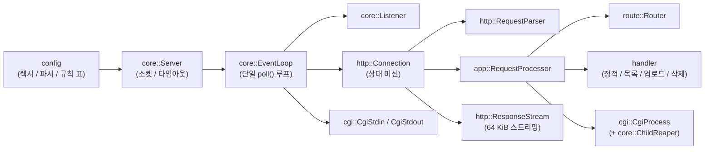

*This project has been created as part of the 42 curriculum by yoshin, jyoo.*

<div align="center">
  
  <h1>webserv</h1>
  <p>C++98과 단일 <code>poll()</code> 루프로 만든 HTTP/1.1 &amp; CGI/1.1 웹 서버</p>
  <p>
    <a href="https://github.com/42GS/webserv/actions/workflows/ci.yml"></a>
    
    
    
  </p>
  <p><strong>한국어</strong> | <a href="README.en.md">English</a></p>
</div>

---

## Description

외부 라이브러리 없이 **C++98**과 POSIX 시스템 콜만으로 구현한 HTTP/1.1 웹 서버다.
프로세스 하나가 `poll()` 루프 하나로 리스닝 소켓, 클라이언트 소켓, CGI 파이프를 모두 처리한다. 소켓과 파이프는 전부 논블로킹 모드로 열며, 준비 이벤트가 올 때마다 `recv()`나 `send()`를 한 번씩만 실행한다.

### 프로젝트 요약

| 항목 | 내용 |
| :--- | :--- |
| 개발 기간 / 인원 | 2026.10.16 ~ 2026.10.29 / 2인 팀 프로젝트 (`yoshin`, `jyoo`) |
| 기술 스택 | C++98 (`-Wall -Wextra -Werror`), POSIX Sockets, `poll()`, CGI/1.1 (`fork`/`execve`) |
| 핵심 구조 | 단일 프로세스 논블로킹 이벤트 루프, 연결 상태 머신(FSM), 8계층 모듈 분리 |
| 테스트 및 검증 | C++98 단위 테스트 `105/105` 통과, Python TCP 통합 테스트 11개 스위트(124케이스), Valgrind·Electric Fence·`siege` 확인 |
| 배포 / CI | GitHub Actions CI, Linux(`x86_64`)·macOS(`arm64`) 릴리스 바이너리 ([v1.0.0](https://github.com/42GS/webserv/releases/tag/v1.0.0)) |
| 상세 문서 | [아키텍처와 설계 메모](docs/architecture.md) · [설정 파일 레퍼런스](docs/configuration.md) · [릴리스 노트](CHANGELOG.md) |

### 주요 구현 사항

* **이벤트 루프와 연결 관리**
  * 단일 `poll()` 루프(`EventLoop`)에서 리스닝 소켓, 클라이언트 소켓, CGI 파이프 I/O를 함께 다룬다.
  * `keep-alive`, HTTP 파이프라이닝(Pipelining), 연결 상태별 타임아웃(유휴/헤더/본문/전송/드레인)을 지원한다.
* **HTTP/1.1 파싱과 라우팅**
  * TCP 패킷이 쪼개져 들어와도 이어서 읽는 증분 파서(`RequestParser`)를 구현했다. `Content-Length`와 `Transfer-Encoding: chunked`를 모두 처리한다.
  * NGINX 스타일 설정 파일(`server`, `location`, `root`, `alias`, `index`, `autoindex`, `return`, `error_page`, `limit_except`, `client_max_body_size`)을 지원한다.
* **파일 서빙과 CGI/1.1**
  * 정적 파일을 서빙하며 `1 MiB`를 넘는 파일은 `64 KiB` 조각 단위로 스트리밍한다. 디렉터리 요청 시 `autoindex` 목록 생성도 가능하다.
  * `multipart/form-data` 파일 업로드(`201`/`409`)와 `DELETE`(`204`)를 처리한다.
  * 파일 확장자 기반 CGI/1.1 실행(`fork`/`execve`), RFC 3875 메타변수 전달, 논블로킹 파이프 I/O, `10초` 타임아웃(`504`), `ChildReaper`를 통한 좀비 회수를 구현했다.
* **보안과 운영**
  * 경로 탈출(`..`)은 `400`으로 막고, 요청 줄(`414`)·헤더(`431`)·본문(`413`) 크기 상한을 강제한다.
  * `logs/access.log`와 `logs/error.log`에 기록을 남기며, `SIGINT`/`SIGTERM`을 받으면 열려 있는 소켓과 CGI 자식 프로세스를 정리하고 종료한다.

### 아키텍처



연결 상태 머신(`READ_HEAD → READ_BODY → WAIT_CGI → WRITE → DRAIN → CLOSED`)과 타임아웃 기준, `dispatch()` 도중 핸들러를 안전하게 빼는 방식은 [docs/architecture.md](docs/architecture.md)에 정리했다.

### 설계상 해결한 문제들

* **시간 함수 없는 시계 (`Clock`)**: 과제 규칙상 `time()`이나 `gettimeofday()`를 쓸 수 없었다. 대신 `poll()` 루프가 한 바퀴 돌 때마다 `.webserv_clock` 파일을 다시 쓰고, 허용 시스템 콜인 `stat()`으로 수정 시각(`st_mtime`)을 읽어 타임아웃과 `Date` 헤더에 썼다.
* **조기 오류 응답 시 TCP RST 회피 (`DRAIN`)**: 본문을 다 읽기 전에 `413` 등을 응답하고 소켓을 바로 닫으면 커널 버퍼에 남은 데이터 때문에 TCP `RST`가 발생해 클라이언트가 응답을 못 받을 수 있다. 닫기 전에 `DRAIN` 상태로 넘겨 남은 입력을 잠시 읽어 버린 뒤 종료한다.
* **FD 고갈 시 CPU 스핀 방지**: 파일 디스크립터가 부족해 `accept()`가 실패하면 `Listener`의 `POLLIN` 감시를 잠깐 멈춘다. 연결이 닫히거나 1초가 지나면 다시 켠다.
* **CGI 보안과 출력 복사 최소화**: `CgiEnv`에서 `Proxy` 헤더를 빼서 `httpoxy`(`CVE-2016-5385`)를 막고, 이름에 `_`가 포함된 헤더도 NGINX처럼 무시한다. CGI 출력은 `16 MiB`까지 모으며 `std::string::swap`으로 복사 없이 넘긴다.

### 릴리스 이력

커밋 내역을 마일스톤별로 묶어 `v0.1.0`부터 `v1.0.0`까지 태그와 릴리스를 발행했다. 자세한 변경 사항은 [CHANGELOG.md](CHANGELOG.md)에 있다.

| Tag | Commit | 주요 변경 사항 |
| :--- | :--- | :--- |
| `v0.1.0` | `6f48721` | `poll()` 이벤트 루프, NGINX 설정 파서, 단위·통합 테스트 하네스 |
| `v0.2.0` | `7404b94` | 증분 HTTP/1.1 파서, 경로 정규화, 라우터, 정적 파일 스트리밍·오토인덱스 |
| `v0.3.0` | `870f06a` | keep-alive, 파이프라이닝, `DRAIN` 상태, 상태별 타임아웃 |
| `v0.4.0` | `3385e7e` | `multipart/form-data` 업로드, `DELETE`, 요청당 업로드 파일 수 제한 |
| `v0.5.0` | `1655980` | 비동기 CGI/1.1 파이프 실행, `502`/`504` 처리, `ChildReaper` |
| `v0.6.0` | `6b4ffc2` | FD 고갈 시 리스너 일시 정지, CGI 출력 무복사 전달, Valgrind·Electric Fence 확인 |
| `v1.0.0` | `4db9510` | 접근/오류 로그, `httpoxy` 차단, C++ 표준 호환성, Linux/macOS 릴리스 바이너리 |

---

## Instructions

### 빌드 및 테스트

```sh
make              # ./webserv 빌드 (-Wall -Wextra -Werror -std=c++98)
make test         # C++98 단위 테스트 실행 (105/105 통과)
make integration  # Python 3 TCP 통합 테스트 실행 (11 suites / 124 cases)
make format       # clang-format 코드 정리
make clean        # 오브젝트 파일 삭제
make fclean       # 빌드 산출물 전체 삭제
```

* `WEBSERV_SLOW_TESTS=1 make integration`: 타임아웃 대기와 전체 빌드 테스트까지 포함해 실행한다.
* `WEBSERV_WRAPPER="valgrind --error-exitcode=99 --leak-check=full" make integration`: 모든 테스트 서버를 Valgrind 아래에서 돌려 누수와 `SIGINT` 종료를 확인한다.
* `siege -b -c 50 -t 1M http://127.0.0.1:8080/empty.html`: 빈 페이지를 대상으로 부하 테스트를 실행한다.

### 실행

데모 설정 안의 `conf/`, `www/`, `logs/` 경로가 상대 경로로 되어 있어 저장소 루트에서 실행해야 한다. 종료할 때는 `Ctrl-C`를 누른다.

```sh
./webserv [설정 파일]   # 기본값: conf/default.conf
```

* 직접 빌드하지 않고 [Releases](https://github.com/42GS/webserv/releases/tag/v1.0.0)에서 Linux(`x86_64`) 또는 macOS(`arm64`)용 `tar.gz` 번들을 받아 바로 실행할 수도 있다.
* CGI 예제는 `/usr/bin/python3`, PHP 예제는 `/usr/bin/php-cgi`가 필요하다.
* 로그는 `logs/access.log`와 `logs/error.log`에 남는다 (`tail -f logs/*.log`).

### 설정 파일 및 데모

지원하는 12개 지시어와 라우팅 우선순위는 [docs/configuration.md](docs/configuration.md)에 정리했다.

| 파일 | 용도 |
| :--- | :--- |
| [conf/default.conf](conf/default.conf) | `127.0.0.1:8080` (`www/`) 메인 데모와 `127.0.0.1:8081` (`www2/`) 보조 사이트 |
| [conf/ports.conf](conf/ports.conf) | 여러 IP와 포트 바인딩 예제 (`127.0.0.2`는 Linux 또는 macOS `lo0` 별칭 필요) |
| [conf/same-port.conf](conf/same-port.conf) | 같은 `interface:port` 중복 시 시작 단계에서 거부되는지 확인하는 예제 (가상 호스트 미지원) |

<details>
<summary><strong>curl 테스트 명령 모음 (펼치기)</strong></summary>

`./webserv conf/default.conf` 실행 후 브라우저에서 `http://127.0.0.1:8080/`을 열거나 아래 명령을 실행한다.

```sh
# 정적 파일, 디렉터리 목록, alias, 리다이렉트, 오류 페이지
curl -i http://127.0.0.1:8080/
curl -i http://127.0.0.1:8080/files/
curl -i http://127.0.0.1:8080/docs/
curl -i http://127.0.0.1:8080/old/                  # 301
curl -i http://127.0.0.1:8080/nothing               # custom 404
curl -i -X DELETE http://127.0.0.1:8080/index.html  # 405
curl -i -X UNKNOWN http://127.0.0.1:8080/           # 501

# 본문 크기 제한 (/limit/ 64바이트)
curl -i -X POST -H "Content-Type: plain/text" --data "BODY IS HERE" \
     http://127.0.0.1:8080/limit/echo.py
curl -i -X POST -H "Content-Type: plain/text" \
     --data "BODY IS HERE write something longer than the body limit of 64 bytes" \
     http://127.0.0.1:8080/limit/echo.py            # 413

# 업로드 (201), 조회 (200), 충돌 (409), 삭제 (204)
curl -i -F "file=@README.md" http://127.0.0.1:8080/upload/
curl -i http://127.0.0.1:8080/upload/README.md
curl -i -X DELETE http://127.0.0.1:8080/upload/README.md

# CGI (GET, POST, chunked, 상대경로, 502, 504 타임아웃, PHP, 쿠키 세션)
curl -i "http://127.0.0.1:8080/cgi-bin/hello.py?name=you"
curl -i -X POST --data "name=a&message=b" http://127.0.0.1:8080/cgi-bin/form.py
curl -i -H "Transfer-Encoding: chunked" --data "chunked body" \
     http://127.0.0.1:8080/cgi-bin/form.py
curl -i http://127.0.0.1:8080/cgi-bin/relative.py
curl -i http://127.0.0.1:8080/cgi-bin/error.py      # 502
curl -i http://127.0.0.1:8080/cgi-bin/loop.py       # 504 (10s)
curl -i http://127.0.0.1:8080/cgi-bin/hello.php
curl -i -c jar -b jar http://127.0.0.1:8080/cgi-bin/session.py
```

</details>

### 디렉터리 구조

```text
.
├── .github/workflows/         # CI 및 릴리스 바이너리 워크플로우
├── conf/                      # NGINX 스타일 설정 파일
├── docs/                      # 아키텍처·설정 문서 (국문 / 영문 .en.md)
├── CHANGELOG.md / .en.md      # 릴리스 노트 (국문 / 영문)
├── README.md / README.en.md   # 프로젝트 개요 (국문 / 영문)
├── include/ & src/
│   ├── core/                  # EventLoop, Server, Listener, Clock, ChildReaper, Signals, Logger
│   ├── config/                # ConfigLexer, ConfigSyntax, DirectiveRules, Builders
│   ├── http/                  # Connection FSM, RequestParser, ResponseStream, Multipart, MimeTypes
│   ├── route/                 # Router, PathResolver
│   ├── handler/               # StaticHandler, AutoindexHandler, UploadHandler, DeleteHandler, StatusPage
│   ├── cgi/                   # CgiProcess, CgiPipes, CgiEnv, CgiOutput
│   ├── fs/                    # FileInfo, FilePath, FileReader, FileWriter
│   └── app/                   # RequestProcessor, ProcessOutcome, ConnectionServices
├── tests/
│   ├── unit/                  # C++98 단위 테스트 (17 files / 105 cases)
│   └── integration/           # Python TCP 통합 테스트 (11 files / 124 cases)
└── www/ & www2/               # 브라우저 데모 페이지 및 CGI 스크립트
```

---

## Resources

* **RFC**: RFC 9110, RFC 9112 (HTTP/1.1), RFC 3986 (URI), RFC 3875 (CGI 1.1), RFC 7578 및 RFC 2046 (`multipart/form-data`), RFC 6265 (Cookies), RFC 1945
* **NGINX**: core, rewrite, index, autoindex 모듈 문서
* **POSIX.1-2024**: `poll`, `recv`, `send`, `bind`, `fcntl`, `waitpid`, `_Exit`, `remove`, `rmdir`, `<signal.h>`
* **PHP / 도구**: `php-cgi` (`REDIRECT_STATUS`), `siege`, Valgrind, Electric Fence, Google C++ Style Guide (`.clang-format`)

### AI 활용 내역

프로젝트 전반에서 Claude Code(Anthropic)를 보조 도구로 썼다. 설계 결정과 코드 리뷰, 최종 테스트 검증은 작성자가 직접 진행했다.

* RFC·POSIX 문서 요약과 OS별 애매한 동작(닫힌 파이프의 `poll()` 비트, `413` 후 연결 종료 방식) 확인용 실험에 활용했다.
* 모듈 구조 제안을 검토한 뒤 핵심 규칙(`..` 탈출 시 `400`, multipart 전용 업로드, `limit_except` 기본값)을 직접 결정했다.
* 코드를 단계별로 작성하고 리뷰하면서 모듈 분리와 불필요한 복사 제거를 진행했다.
* 단위·통합 테스트를 함께 작성했고 `valgrind`, Electric Fence, `siege`로 안정성을 별도 검증했다.
