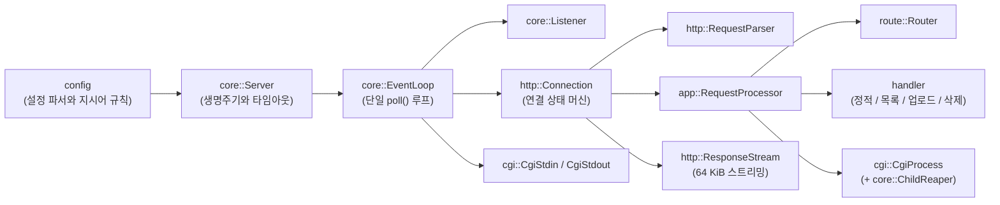

*This project has been created as part of the 42 curriculum by yoshin, jyoo.*

<div align="center">
  
  <h1>webserv</h1>
  <p>C++98로 만든 단일 프로세스 <code>poll()</code> 기반 HTTP/1.1 &amp; CGI/1.1 웹 서버</p>
  <p>
    <a href="https://github.com/42GS/webserv/actions/workflows/ci.yml"></a>
    
    
    
  </p>
  <p>
    <strong>한국어</strong> | <a href="README.en.md">English</a>
  </p>
  <p>
    <a href="docs/architecture.md">아키텍처와 설계 메모</a> ·
    <a href="docs/configuration.md">설정 파일 레퍼런스</a> ·
    <a href="CHANGELOG.md">릴리스 노트</a>
  </p>
</div>

---

## Description

`webserv`는 외부 라이브러리 없이 C++98로 바닥부터 구현한 HTTP/1.1 웹 서버다.
프로세스 하나가 `poll()` 루프 하나로 리스닝 소켓, 클라이언트 소켓, CGI 파이프를 전부 돌린다. 소켓과 파이프는 모두 논블로킹으로 열고, `poll()` 이벤트가 한 번 오면 `recv()`나 `send()`를 한 번만 실행한다.

웹 서버 동작과 시스템 프로그래밍 쪽을 모두 다뤄본 프로젝트다. 백엔드 쪽에서는 HTTP/1.1 요청 파싱, 라우팅, 파일 업로드와 삭제, CGI 실행을 구현했다. 시스템 쪽에서는 단일 이벤트 루프, 소켓 생명주기, 논블로킹 파이프 I/O, 자식 프로세스 회수, 타임아웃과 메모리 안전성 처리를 직접 작성했다.

### 구현한 주요 기능

| 영역 | 내용 |
| :--- | :--- |
| **이벤트 루프와 연결 관리** | 단일 `poll()` 루프(`EventLoop`), 연결 상태 머신(`Connection`), `keep-alive`와 파이프라이닝, 연결 상태별 타임아웃 |
| **HTTP/1.1 요청 파싱** | TCP 분할 수신을 처리하는 증분 파서(`RequestParser`), `Content-Length`와 `Transfer-Encoding: chunked`, 헤더/요청줄 크기 제한(`413`, `414`, `431`) |
| **라우팅과 설정** | NGINX 스타일 설정(`server`, `location`, `root`, `alias`, `index`, `autoindex`, `return`, `error_page`, `limit_except`, `client_max_body_size`) |
| **파일 서빙과 업로드** | 정적 파일 서빙(`1 MiB` 초과 파일은 `64 KiB`씩 스트리밍), 디렉터리 목록, `multipart/form-data` 업로드(`201`/`409`), `DELETE`(`204`) |
| **CGI/1.1 실행** | 확장자 기반 CGI 실행(`fork`/`execve`), RFC 3875 메타변수, 논블로킹 파이프 입출력, `10초` 타임아웃(`504`), 비정상 종료 시 `502` |
| **보안과 운영** | 경로 탈출(`..`) 차단(`400`), `httpoxy`(`CVE-2016-5385`) 및 `_` 포함 헤더 필터링, `logs/access.log`·`logs/error.log` 기록, `SIGINT`/`SIGTERM` 정리 종료 |

### 전체 구조



상태 머신(`READ_HEAD → READ_BODY → WAIT_CGI → WRITE → DRAIN → CLOSED`)이나 모듈 구조, 타임아웃 값은 [아키텍처와 설계 메모](docs/architecture.md)에 따로 정리해 두었다.

### 설계하면서 신경 쓴 부분들

* **시간 함수 없이 현재 시각 구하기 (`Clock`):** 과제 조건 때문에 `time()`이나 `gettimeofday()` 같은 시간 함수를 쓸 수 없었다. 그래서 `poll()` 루프가 한 바퀴 돌 때마다 `.webserv_clock` 파일을 다시 쓰고, 허용 함수인 `stat()`으로 수정 시각(`st_mtime`)을 읽어 타임아웃과 `Date` 헤더에 썼다.
* **오류 응답 전 TCP RST 피하기 (`DRAIN`):** 본문을 다 읽기 전에 `413` 같은 오류를 보내고 소켓을 바로 닫으면, 커널 버퍼에 남은 데이터 때문에 OS가 `RST`를 보내면서 클라이언트가 응답을 못 받는 경우가 생긴다. `DRAIN` 상태를 두어 잠시 남은 입력을 버린 뒤 닫도록 했다.
* **FD가 꽉 찼을 때 CPU 스핀 막기:** 파일 디스크립터가 부족해 `accept()`가 실패하면 `Listener`의 `POLLIN` 감시를 잠깐 멈춘다. 연결이 닫히거나 1초가 지나면 다시 켠다.
* **CGI 보안과 출력 제한:** `CgiEnv`에서 `Proxy` 헤더를 빼서 `HTTP_PROXY`가 들어가지 않게 막았고(`httpoxy`), 이름에 `_`가 있는 헤더도 NGINX처럼 무시한다. CGI 출력은 `16 MiB`까지만 모으고, 결과를 넘길 때는 `std::string::swap`으로 복사 없이 넘긴다.

### 버전별 진행 내역

커밋 기록을 정리해서 `v0.1.0`부터 `v1.0.0`까지 태그와 릴리스로 묶었다. 자세한 내용은 [CHANGELOG.md](CHANGELOG.md)에 있다.

| Tag | Commit | 내용 |
| :--- | :--- | :--- |
| `v0.1.0` | `6f48721` | 단일 `poll()` 이벤트 루프, NGINX 스타일 설정 파서, 단위·통합 테스트 틀 |
| `v0.2.0` | `7404b94` | 증분 HTTP/1.1 파서, 경로 정규화, 라우터, 정적 파일 스트리밍과 목록 |
| `v0.3.0` | `870f06a` | keep-alive, 파이프라이닝, `DRAIN` 상태, 연결 상태별 타임아웃 |
| `v0.4.0` | `3385e7e` | `multipart/form-data` 업로드, `DELETE`, 업로드 파일 수 제한 |
| `v0.5.0` | `1655980` | 비동기 CGI/1.1 파이프 실행, `502`/`504` 처리, `ChildReaper` |
| `v0.6.0` | `6b4ffc2` | FD 고갈 시 리스너 일시 정지, CGI 출력 무복사 전달, Valgrind와 Electric Fence 확인 |
| `v1.0.0` | `4db9510` | 접근/오류 로그, `httpoxy` 차단, 최신 C++ 빌드 호환성, 리눅스/macOS 릴리스 바이너리 |

---

## Instructions

### 빌드와 테스트

```sh
make              # ./webserv 빌드 (c++ -Wall -Wextra -Werror -std=c++98)
make test         # C++98 단위 테스트 실행 (./run_tests)
make integration  # Python 3 표준 라이브러리 통합 테스트 실행
make format       # clang-format 적용 (.clang-format)
make clean        # 오브젝트 파일 삭제
make fclean       # 빌드 결과물 전부 삭제
```

* **단위 테스트 (`tests/unit/`):** 외부 라이브러리 없이 직접 만든 테스트 러너([TestFramework.hpp](tests/unit/TestFramework.hpp))와 `EventLoop` 테스트 더블로 돌린다. **105/105 통과**를 확인했다.
* **통합 테스트 (`tests/integration/`):** 서버를 실제로 띄워 TCP로 요청을 보내는 Python `unittest` 스위트 11개(테스트 케이스 124개)가 있다. `WEBSERV_SLOW_TESTS=1`을 주면 타임아웃 테스트까지 돌고, `WEBSERV_WRAPPER="valgrind --error-exitcode=99 --leak-check=full"`을 주면 모든 테스트 서버가 Valgrind 아래에서 누수 없이 종료되는지 검사한다.
* **부하 테스트:** `siege -b -c 50 -t 1M http://127.0.0.1:8080/empty.html`로 테스트할 수 있게 빈 페이지도 넣어 두었다.

### 실행

데모 설정 파일 안의 경로(`www/`, `logs/`, `conf/`)가 상대 경로이므로 저장소 루트에서 실행해야 한다. `logs/` 디렉터리가 있어야 하고, `Ctrl-C`(`SIGINT`/`SIGTERM`)를 누르면 연결과 CGI 자식 프로세스를 정리하고 종료한다.

```sh
./webserv [설정 파일]   # 기본값: conf/default.conf
```

* CGI 예제는 `/usr/bin/python3`을 쓰고, PHP 예제(`/cgi-bin/hello.php`)는 `/usr/bin/php-cgi`가 필요하다.
* 로그는 `logs/access.log`와 `logs/error.log`에 남는다 (`tail -f logs/*.log`).
* 실행한 디렉터리에 시간 측정용 `.webserv_clock` 파일이 생긴다.

### 데모 설정과 테스트 명령

지원하는 12개 지시어와 라우팅 순서는 [설정 파일 레퍼런스](docs/configuration.md)에 정리해 두었다.

| 파일 | 용도 |
| :--- | :--- |
| [conf/default.conf](conf/default.conf) | `127.0.0.1:8080` (`www/`) 메인 데모와 `127.0.0.1:8081` (`www2/`) 두 번째 사이트 |
| [conf/ports.conf](conf/ports.conf) | 여러 IP와 포트 바인딩 예제 (`127.0.0.2`는 리눅스나 macOS `lo0` 별칭 필요) |
| [conf/same-port.conf](conf/same-port.conf) | 같은 `interface:port` 중복 시 시작 단계에서 거부하는 예제 (가상 호스트 미지원) |

<details>
<summary><strong>브라우저 데모와 curl 명령 모음 (펼치기)</strong></summary>

`./webserv conf/default.conf`를 띄운 뒤 브라우저에서 `http://127.0.0.1:8080/`을 열거나 아래 `curl` 명령을 실행해 볼 수 있다.

```sh
# 정적 파일, 디렉터리 목록, alias, 리다이렉트, 오류 페이지
curl -i http://127.0.0.1:8080/                      # 정적 페이지
curl -i http://127.0.0.1:8080/files/                # 디렉터리 목록 (autoindex)
curl -i http://127.0.0.1:8080/docs/                 # alias 경로
curl -i http://127.0.0.1:8080/old/                  # 301 리다이렉트
curl -i http://127.0.0.1:8080/nothing               # 커스텀 404 페이지
curl -i -X DELETE http://127.0.0.1:8080/index.html  # 405 Method Not Allowed
curl -i -X UNKNOWN http://127.0.0.1:8080/           # 501 Not Implemented

# 본문 크기 제한 (/limit/ 경로 64바이트 제한)
curl -i -X POST -H "Content-Type: plain/text" --data "BODY IS HERE" \
     http://127.0.0.1:8080/limit/echo.py
curl -i -X POST -H "Content-Type: plain/text" \
     --data "BODY IS HERE write something longer than the body limit of 64 bytes" \
     http://127.0.0.1:8080/limit/echo.py            # 413 Payload Too Large

# 멀티파트 업로드 (201), 다운로드 (200), 중복 충돌 (409), 삭제 (204)
curl -i -F "file=@README.md" http://127.0.0.1:8080/upload/
curl -i http://127.0.0.1:8080/upload/README.md
curl -i -X DELETE http://127.0.0.1:8080/upload/README.md

# CGI (GET 쿼리, POST 폼, 청크 본문, 상대 경로, 502, 504 타임아웃, PHP, 쿠키 세션)
curl -i "http://127.0.0.1:8080/cgi-bin/hello.py?name=you"
curl -i -X POST --data "name=a&message=b" http://127.0.0.1:8080/cgi-bin/form.py
curl -i -H "Transfer-Encoding: chunked" --data "chunked body" \
     http://127.0.0.1:8080/cgi-bin/form.py
curl -i http://127.0.0.1:8080/cgi-bin/relative.py   # 스크립트 디렉터리 기준 실행
curl -i http://127.0.0.1:8080/cgi-bin/error.py      # 502 Bad Gateway
curl -i http://127.0.0.1:8080/cgi-bin/loop.py       # 504 Gateway Timeout (10초)
curl -i http://127.0.0.1:8080/cgi-bin/hello.php     # 보너스: PHP CGI
curl -i -c jar -b jar http://127.0.0.1:8080/cgi-bin/session.py

# siege 부하 테스트
siege -b -c 50 -t 1M http://127.0.0.1:8080/empty.html
```

</details>

### 디렉터리 구조

```text
.
├── .github/workflows/         # GitHub Actions CI 및 릴리스 바이너리 워크플로우
├── conf/                      # NGINX 스타일 설정 파일 예제
├── docs/                      # 아키텍처와 설정 문서 (국문 / 영문 .en.md)
├── CHANGELOG.md / .en.md      # 릴리스 노트 (국문 / 영문)
├── README.md / README.en.md   # 프로젝트 설명 (국문 / 영문)
├── include/ & src/
│   ├── core/                  # EventLoop (poll), Server, Listener, Clock, ChildReaper, Signals, Logger
│   ├── config/                # ConfigLexer, ConfigSyntax, DirectiveRules, Builders
│   ├── http/                  # Connection 상태 머신, RequestParser, ResponseStream, Multipart, MimeTypes
│   ├── route/                 # Router, PathResolver (경로 정규화와 탈출 차단)
│   ├── handler/               # StaticHandler, AutoindexHandler, UploadHandler, DeleteHandler, StatusPage
│   ├── cgi/                   # CgiProcess, CgiPipes, CgiEnv, CgiOutput
│   ├── fs/                    # FileInfo, FilePath, FileReader, FileWriter
│   └── app/                   # RequestProcessor, ProcessOutcome, ConnectionServices
├── tests/
│   ├── unit/                  # C++98 단위 테스트 17개 파일 (105개 케이스)
│   └── integration/           # Python TCP 통합 테스트 11개 파일 (124개 케이스)
└── www/ & www2/               # 브라우저 데모 페이지와 CGI 스크립트
```

---

## Resources

* **IETF RFC:** RFC 9110 (HTTP Semantics), RFC 9112 (HTTP/1.1), RFC 3986 (URI), RFC 3875 (CGI 1.1), RFC 7578 및 RFC 2046 (`multipart/form-data`), RFC 6265 (Cookies), RFC 1945 (HTTP/1.0).
* **NGINX 문서:** core, rewrite, index, autoindex 모듈의 설정 문법과 동작.
* **POSIX.1-2024:** `poll`, `recv`, `send`, `bind`, `fcntl`, `waitpid`, `_Exit`, `remove`, `rmdir`, `<signal.h>`.
* **PHP 매뉴얼과 `php-cgi` 소스:** `cgi.force_redirect`와 `REDIRECT_STATUS` 처리.
* **도구와 스타일:** `siege` 매뉴얼, Valgrind, Electric Fence, C++ Core Guidelines, Google C++ Style Guide (`.clang-format`).

### AI 활용 내역

프로젝트 전반에서 Claude Code(Anthropic)를 함께 썼다. 설계 결정과 코드 리뷰, 테스트 검증은 직접 챙겼다.

* **자료 정리와 OS 실험:** RFC나 POSIX 문서를 요약하고, 문서만으로 애매한 동작(닫힌 파이프의 `poll()` 비트나 `413` 응답 후 연결 종료 방식 등)은 macOS와 Ubuntu 22.04에서 직접 작은 실험을 돌려 확인했다.
* **설계 결정:** 클래스 구조 안을 받아서 검토하고, 실제 기준(`..` 상위 탈출 시 `400`, multipart 업로드만 허용, `limit_except` 없으면 `GET`/`HEAD`만 허용 등)은 우리가 직접 정했다.
* **구현과 리팩토링:** C++ 코드를 단계별로 작성할 때마다 읽고 고쳤고, 리뷰 후 모듈 분리나 불필요한 복사 제거를 반복했다.
* **테스트와 검증:** 단위 테스트와 Python 통합 테스트를 함께 작성했고, `valgrind`, Electric Fence, `siege`로 안정성을 따로 확인했다.
