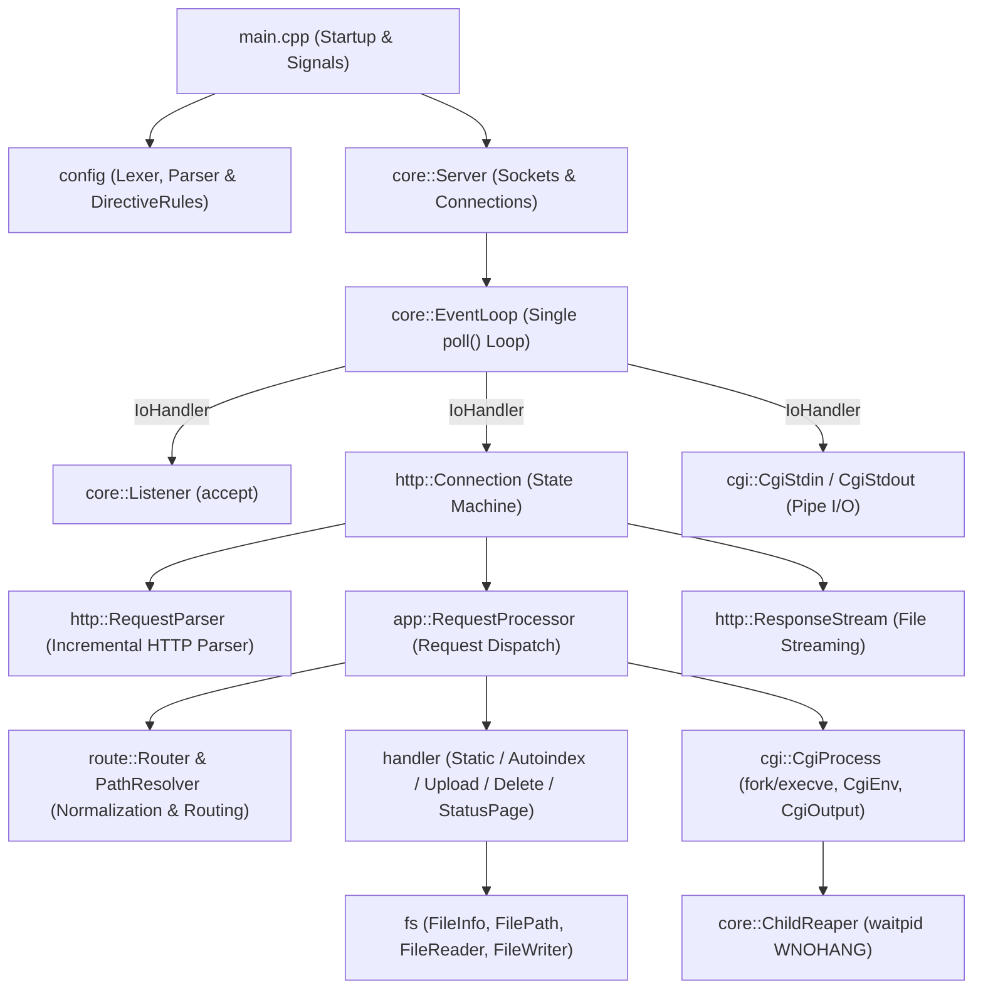
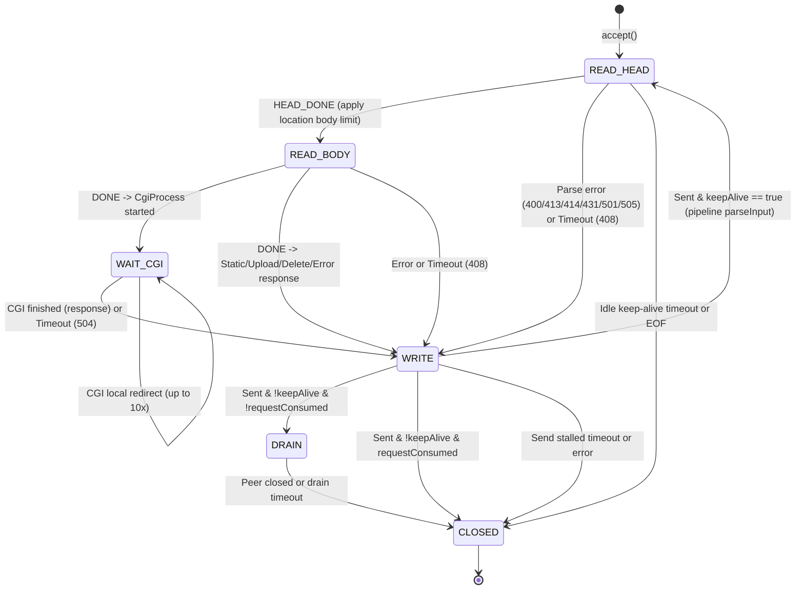

[한국어](architecture.md) | **English** · [Back to README](../README.en.md)

# Architecture & Design Notes

Notes on how `webserv` works internally and why certain choices were made.

---

## 1. Module Layout

The code is split into 8 directories under `include/` and `src/`. Dependencies point downward toward `core`, `fs`, and `http`.

| Directory | What it handles |
| :--- | :--- |
| `core/` | Single `poll()` loop, listening sockets, `.webserv_clock`, signal flags, child reaping, logging |
| `config/` | Config tokenizer, syntax parser, table-driven `DirectiveRules`, server and location builders |
| `http/` | Connection state machine, incremental RFC 9112 parser, response streaming, multipart parser, MIME types |
| `route/` | Path normalization, traversal rejection (`..`), longest-prefix location matching |
| `handler/` | Static files, directory listings (`autoindex`), uploads, `DELETE`, status pages |
| `cgi/` | CGI meta-variables, header filtering, non-blocking pipe I/O, CGI output parsing |
| `fs/` | File info checks, path joining, bounded file reads and writes |
| `app/` | Connects parsed requests to routing, handlers, CGI launch, and common headers (`Date`, `Connection`) |

---

## 2. Single `poll()` Loop & Deferred Removal

`EventLoop` (`include/core/EventLoop.hpp`, `src/core/EventLoop.cpp`) watches every file descriptor—listening sockets, client sockets, and CGI pipes—in one thread using one `poll()` call with a `1000 ms` timeout.

### Why `unwatch()` marks handlers instead of erasing immediately
Inside `dispatch()`, an `IoHandler::onEvent()` call may close a connection or finish a CGI pipe and call `unwatch()`. Erasing from `handlers_` mid-loop would break iteration or touch a deleted handler later in the same pass.

1. `dispatch()` copies `handlers_` into `polled` and sets `dispatching_ = true`.
2. `unwatch(handler)` adds the pointer to `unwatched_` and skips any remaining events for that handler in the current round.
3. After `dispatch()` returns, `dropUnwatched()` removes marked handlers from `handlers_`. Closed `Connection` objects are deleted outside dispatch in `Server::afterIteration()`.

### Exception Isolation & FD Exhaustion
* **Per-connection isolation:** If `std::exception` (such as `std::bad_alloc`) escapes a handler or timeout check, `EventLoop::dispatch()` and `Server::afterIteration()` call `onFailure()` to close just that connection instead of bringing down the server.
* **Pausing listeners when FDs run out:** When `accept()` fails because the descriptor table is full, `Listener` pauses `POLLIN` polling (`Server::acceptFailed`). Otherwise the loop would spin at 100% CPU failing `accept()` on every pass. `Server::afterIteration()` calls `resume()` after a connection closes or one second passes.

---

## 3. Connection State Machine & Timeouts

Each client socket belongs to one `http::Connection`. Each readiness event triggers at most one `recv()` or `send()`.

### Why `DRAIN` is there (RFC 9112 §9.6)
If the server sends an early error like `413` and closes the socket while unread request bytes are still sitting in the kernel receive buffer, the OS sends a TCP `RST`. That reset can erase the error response before the client reads it. Moving to `DRAIN` lets the server read and discard remaining bytes briefly (`1s` idle, `5s` total) before closing.

### Limits and Timeouts (`include/core/Limits.hpp`, `include/config/ConfigLimits.hpp`)

| Constant | Value | Purpose |
| :--- | :--- | :--- |
| `kPollTimeoutMs` | `1000 ms` | `poll()` timeout so periodic timeout checks run |
| `kKeepAliveTimeoutSeconds` | `15 s` | Wait for the first byte on a new or kept-alive connection (silent close) |
| `kHeaderTimeoutSeconds` | `30 s` | Total time allowed for the request head after its first byte |
| `kBodyTimeoutSeconds` | `30 s` | Idle time allowed while receiving the request body |
| `kSendTimeoutSeconds` | `30 s` | Idle time allowed without `send()` progress |
| `kDrainIdleSeconds` / `Total` | `1 s` / `5 s` | Idle and total limits while draining unread input before close |
| `kCgiTimeoutSeconds` | `10 s` | Time allowed for a CGI script to finish (`504` if exceeded) |
| `kMaxRequestLine` / `kMaxHeaderBytes` | `8 KiB` / `16 KiB` | Max request line (`414`) and max header + trailer bytes (`431`) |
| `kInMemoryFileLimit` / `kFileChunkSize` | `1 MiB` / `64 KiB` | Cutoff for in-memory static files and piece size for streamed files |
| `kMaxCgiOutputBytes` | `16 MiB` | Max buffered CGI output (`502` if exceeded) |
| `kMaxUploadFiles` | `5` | Max files stored by one upload request (`413` if exceeded) |
| `kDefaultMaxBodySize` / `Ceiling` | `1 MiB` / `100 MiB` | Default and maximum configurable `client_max_body_size` |

---

## 4. Incremental HTTP/1.1 Parser

`RequestParser` (`include/http/RequestParser.hpp`) parses incoming bytes regardless of how TCP splits packets:

1. **One erase per `feed()` (`consumed_`):** Tracks how many bytes were consumed and erases from `inBuffer_` once at the end of `feed()`. Any pipelined bytes for the next request stay in the buffer.
2. **Two-step body limit (`HEAD_DONE`):** `maxBodySize_` starts at `0`. Once the head finishes (`HEAD_DONE`), `Connection` asks `RequestProcessor::bodyLimitFor()` for the matched location's `client_max_body_size` before reading the body.
3. **Framing and trailers:** Handles `Content-Length` (checking for integer overflow) and `Transfer-Encoding: chunked` including trailers. Trailer lines count toward `kMaxHeaderBytes`.

---

## 5. Non-blocking CGI/1.1 & Security

`CgiProcess` (`include/cgi/CgiProcess.hpp`, `src/cgi/CgiEnv.cpp`) runs scripts without stalling the `poll()` loop:

* **Pipe polling:** `CgiStdin` and `CgiStdout` implement `IoHandler` and register with `EventLoop`. In the child process, `runChild()` wires stdin/stdout via `dup2`, closes inherited descriptors, `chdir()`s into the script's directory, and calls `execve()`.
* **Avoiding large copies:** Output (up to `16 MiB`) is handed back in `takeOutput()` using `std::string::swap` so C++98 NRVO avoids copying multi-megabyte strings.
* **Child reaping (`ChildReaper`):** Finished or killed (`SIGKILL`) CGI PIDs are passed to `ChildReaper`, which calls `waitpid(pid, ..., WNOHANG)` on each loop iteration so no zombie processes remain.
* **Security checks:**
  * `CgiEnv` strips `Proxy` so `HTTP_PROXY` cannot be injected (`httpoxy`, `CVE-2016-5385`).
  * Header names with `_` are dropped, matching NGINX defaults, so `X_FOO` cannot collide with `HTTP_X_FOO` from `X-Foo`.
  * `PathResolver` percent-decodes once, resolves `.` and `..`, rejects paths escaping above root with `400 Bad Request`, and requires `alias` matches on segment boundaries.

---

## 6. Wall-Clock Time Without Time Functions (`.webserv_clock`)

* **Constraint:** The 42 `webserv` subject forbids standard time calls (`time()`, `gettimeofday()`, `clock_gettime()`).
* **Workaround (`Clock`):** Once per `EventLoop` iteration, `Clock::refresh()` rewrites `.webserv_clock` and reads its modification timestamp (`st_mtime`) using `stat()`, which is allowed.
* **Where it is used:** All connection timeouts, CGI timeouts, and RFC 9110 `Date` headers read from this single `Clock` class, making it easy to unit test (`clock_test.cpp`).
