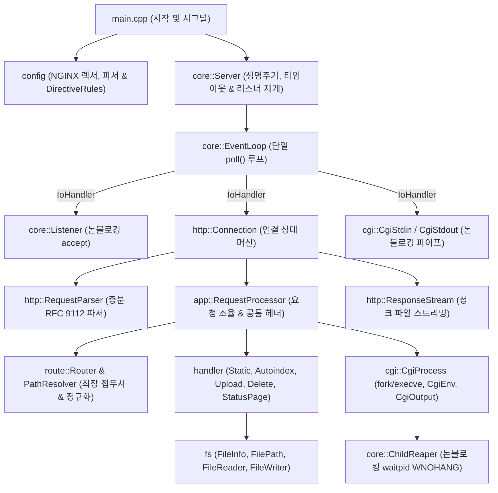
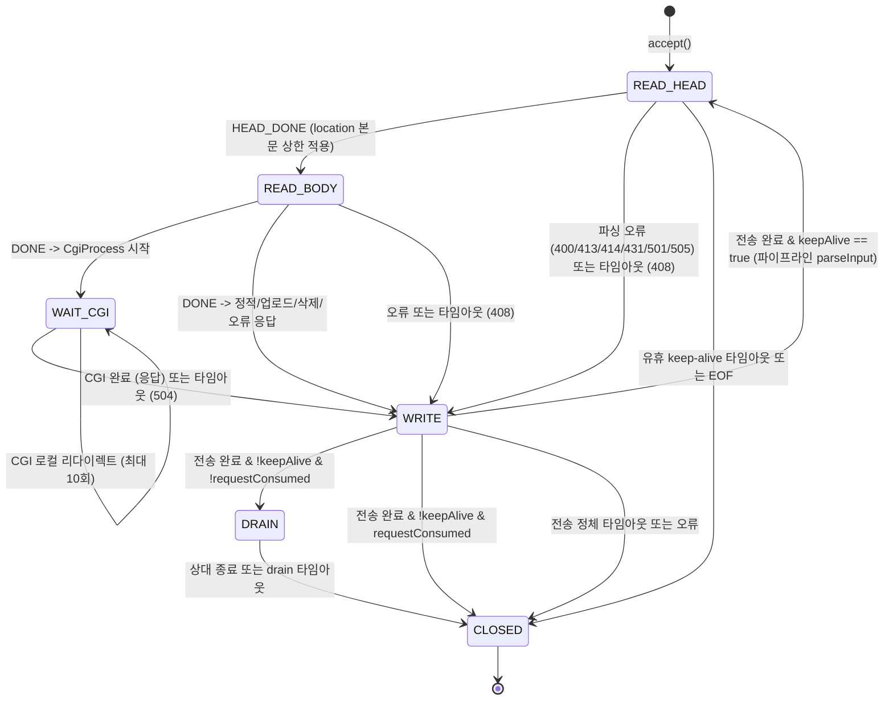

[English](architecture.md) | **한국어** · [README로 돌아가기](../README.ko.md)

# 아키텍처 및 설계 의사결정

> **webserv**의 상세 기술 문서입니다. **백엔드(HTTP/1.1, CGI/1.1)** 및 **시스템·네트워크(논블로킹 `poll()`, POSIX IPC, 리소스 격리)** 직무 관점 모두에서 설계 근거를 확인할 수 있도록 정리했습니다.

---

## 1. 계층형 모듈 아키텍처

코드베이스는 `include/`와 `src/` 아래 **8개의 응집도 높은 계층**으로 분리되어 있으며, 의존성은 하위 인프라(`core`, `fs`, `http`) 방향으로만 흐릅니다.

| 계층 | 디렉터리 | 역할 |
| :--- | :--- | :--- |
| **Core** | `core/` | 단일 `poll()` 이벤트 루프, 리스너, 파일 `mtime` 기반 시계, 시그널 플래그, 좀비 프로세스 회수, 로거 |
| **Config** | `config/` | 렉서, 구문 파서, 테이블 기반 지시어 검증(`DirectiveRules`), 서버/로케이션 설정 빌더 |
| **HTTP** | `http/` | 연결 상태 머신, 증분 RFC 9112 파서, 스트리밍 응답, `multipart/form-data` 파서, MIME 타입 |
| **Route** | `route/` | RFC 3986 경로 정규화, 루트 탈출 차단(`400`), 최장 접두사(Longest-prefix) 라우팅 |
| **Handler** | `handler/` | 정적 파일, 디렉토리 목록(`autoindex`), 멀티파트 업로드(`201`/`409`), 삭제(`DELETE`), 상태 페이지 |
| **CGI** | `cgi/` | RFC 3875 메타변수, `httpoxy` 필터링, 논블로킹 파이프 I/O, CGI 출력 헤더 파싱 |
| **FS** | `fs/` | 파일 메타데이터 조회, 경로 조합, 상한 제한 파일 읽기/쓰기 추상화 |
| **App** | `app/` | 요청을 라우팅·핸들러·CGI와 연결하고 공통 응답 헤더(`Date`, `Connection`) 부여 |

---

## 2. 단일 `poll()` 루프와 재진입 안전성

`EventLoop`(`include/core/EventLoop.hpp`, `src/core/EventLoop.cpp`)는 리스닝 소켓, 클라이언트 소켓, CGI 표준입출력 파이프 등 **모든 파일 디스크립터**를 단일 OS 스레드 내 하나의 `poll()` 호출(`limits::kPollTimeoutMs = 1000 ms`)로 다중화합니다.

### 지연 제거(`unwatched_` + `dropUnwatched()`) 설계 이유
`EventLoop::dispatch()`가 이벤트 목록을 순회하는 도중 `IoHandler::onEvent()`가 연결을 닫거나 CGI 파이프를 종료하면서 `EventLoop::unwatch()`를 호출할 수 있습니다. 이때 `handlers_` 벡터에서 즉시 요소를 삭제하면 반복자가 무효화되거나 같은 회차의 남은 이벤트 처리 중 해제된 객체에 접근(Use-After-Free)할 위험이 있습니다.

1. `dispatch()`는 `handlers_` 스냅샷(`polled`)을 만들고 `dispatching_ = true`로 설정합니다.
2. `unwatch(handler)`는 해당 포인터를 `unwatched_` 집합에 표시만 해 두고, 현재 회차의 남은 이벤트를 건너뜁니다.
3. `dispatch()`가 끝난 뒤 `dropUnwatched()`가 표시된 핸들러를 안전하게 제거하며, 닫힌 `Connection` 객체의 `delete`는 이벤트 분배 밖인 `Server::afterIteration()`에서 수행합니다.

### 장애 격리와 FD 고갈 역압 제어
* **연결 단위 예외 격리 (`EventLoop::dispatch` & `Server::afterIteration`):** 단일 핸들러나 타임아웃 검사에서 `std::bad_alloc` 등 `std::exception`이 발생하더라도 전체 서버 프로세스를 중단하지 않고 해당 핸들러의 `onFailure()`만 호출해 문제 연결만 종료합니다.
* **리스너 일시 정지/재개 (`Server::acceptFailed`):** 파일 디스크립터 테이블 고갈(`EMFILE` 등)로 `accept()`가 실패하면 `Listener`의 `POLLIN` 감시를 일시 정지해 `poll()` 루프가 CPU 100% 스핀 상태에 빠지는 것을 막고, `Server::afterIteration()`에서 연결이 닫히거나 1초가 지난 뒤 `resume()`으로 재개합니다.

---

## 3. 연결 상태 머신 및 타임아웃

각 클라이언트 소켓은 `http::Connection`(`include/http/Connection.hpp`, `src/http/Connection.cpp`)이 소유하며, `poll()` 준비 이벤트당 **최대 한 번의 `recv()` 또는 `send()`**만 수행합니다.

### `DRAIN` 상태를 둔 이유 (RFC 9112 §9.6)
요청 본문을 끝까지 읽기 전에 서버가 조기 오류 응답(`413 Payload Too Large`, `408` 등)을 보내고 소켓을 즉시 닫으면, 커널 수신 버퍼에 남은 데이터 때문에 OS가 TCP `RST` 패킷을 전송해 클라이언트가 오류 응답을 읽기 전에 연결이 끊어질 수 있습니다. `DRAIN` 상태는 짧은 시간(`kDrainIdleSeconds = 1s`, `kDrainTotalSeconds = 5s`) 동안 잔여 입력을 읽어 버린 뒤 정상 종료해 응답 유실을 방지합니다.

### 타임아웃 및 리소스 상한 (`include/core/Limits.hpp`, `include/config/ConfigLimits.hpp`)

| 상수 | 값 | 목적 |
| :--- | :--- | :--- |
| `kPollTimeoutMs` | `1000 ms` | 타임아웃 검사를 위한 `poll()` 주기 |
| `kKeepAliveTimeoutSeconds` | `15 s` | Keep-Alive 유휴 대기 (초과 시 무응답 종료) |
| `kHeaderTimeoutSeconds` | `30 s` | 첫 바이트부터 헤더 완료까지 총 제한 시간 (Slowloris 방어) |
| `kBodyTimeoutSeconds` | `30 s` | 요청 본문 수신 중 무진행 허용 시간 |
| `kSendTimeoutSeconds` | `30 s` | 응답 전송 중 무진행 허용 시간 |
| `kDrainIdleSeconds` / `Total` | `1 s` / `5 s` | 연결 종료 전 잔여 입력 폐기 시간 |
| `kCgiTimeoutSeconds` | `10 s` | CGI 스크립트 최대 실행 시간 (`504`) |
| `kMaxRequestLine` / `kMaxHeaderBytes` | `8 KiB` / `16 KiB` | 요청 줄(`414`) 및 헤더+트레일러(`431`) 크기 상한 |
| `kInMemoryFileLimit` / `kFileChunkSize` | `1 MiB` / `64 KiB` | 대용량 정적 파일 스트리밍 임계치 및 청크 크기 |
| `kMaxCgiOutputBytes` | `16 MiB` | CGI 출력 메모리 상한 (초과 시 `502`) |
| `kMaxUploadFiles` | `5` | 단일 업로드 요청당 최대 파일 수 (루프 블로킹 방지) |
| `kDefaultMaxBodySize` / `Ceiling` | `1 MiB` / `100 MiB` | 기본 및 설정 가능한 최대 요청 본문 크기 상한 |

---

## 4. 증분 HTTP/1.1 파서와 본문 상한 연동

`RequestParser`(`include/http/RequestParser.hpp`)는 임의의 TCP 분할 수신과 HTTP 파이프라이닝을 처리합니다.

1. **커서 기반 버퍼 소비 (`consumed_`):** `feed()` 호출 중 사용한 바이트 위치만 추적했다가 함수 종료 시 한 번에 `inBuffer_`에서 제거해 불필요한 메모리 이동을 줄입니다. 뒤따르는 파이프라인 요청 바이트는 그대로 버퍼에 유지됩니다.
2. **2단계 본문 상한 적용 (`HEAD_DONE`):** 헤더 파싱 완료 전까지는 `maxBodySize_`를 `0`으로 두었다가, `HEAD_DONE` 반환 직후 `Connection`이 `RequestProcessor::bodyLimitFor()`를 통해 매칭된 `location`의 `client_max_body_size`를 조회·적용합니다.
3. **프레이밍 및 보안:** 오버플로우 방어가 적용된 `Content-Length`와 트레일러 포함 `Transfer-Encoding: chunked`를 지원하며, 트레일러 크기도 `kMaxHeaderBytes`에 합산해 헤더 상한 우회를 차단합니다.

---

## 5. 비동기 CGI/1.1 및 보안 강화

`CgiProcess`(`include/cgi/CgiProcess.hpp`, `src/cgi/CgiEnv.cpp`)는 이벤트 루프를 멈추지 않고 CGI 스크립트를 실행합니다.

* **논블로킹 파이프 다중화:** 입력(`CgiStdin`) 및 출력(`CgiStdout`) 파이프를 `IoHandler`로 `EventLoop`에 등록합니다. 자식 프로세스(`runChild()`)는 `dup2`로 표준입출력을 연결하고, 상속된 다른 파일 디스크립터를 닫은 뒤 스크립트 디렉터리로 `chdir()`하여 `execve()`를 실행합니다.
* **무복사 출력 전달:** 수집한 CGI 출력(최대 `16 MiB`)은 `takeOutput()`에서 `std::string::swap`과 C++98 NRVO를 통해 대용량 버퍼 복사 없이 전달됩니다.
* **좀비 프로세스 방지 (`ChildReaper`):** 종료되었거나 타임아웃(`SIGKILL`)으로 중단된 CGI PID는 `ChildReaper`로 인계되어 매 반복마다 `waitpid(pid, ..., WNOHANG)`으로 논블로킹 회수됩니다.
* **`CgiEnv.cpp` 및 `PathResolver` 보안 조치:**
  * **CVE-2016-5385 (`httpoxy`):** 요청의 `Proxy` 헤더를 제거해 `HTTP_PROXY` 환경변수 주입 공격을 차단합니다.
  * **헤더 스푸핑 방지:** NGINX 기본 동작과 동일하게 밑줄(`_`)이 포함된 요청 헤더를 무시하여, `X_FOO`가 `X-Foo`의 `HTTP_X_FOO`와 충돌하지 않도록 방어합니다.
  * **경로 탈출 차단 (`PathResolver`):** 퍼센트 인코딩을 한 번만 디코딩하고 `.`/`..`을 정규화하며, 루트(`/`) 상위 탈출 시도는 `400 Bad Request`로 거부합니다. `alias` 위치 매칭도 세그먼트 경계에서만 허용합니다.

---

## 6. 허용 함수 제약 해결: `.webserv_clock`

* **제약:** 42 `webserv` 과제에서는 표준 C/POSIX 시간 함수(`time()`, `gettimeofday()`, `clock_gettime()`) 사용이 금지되어 있습니다.
* **구현 (`core::Clock`):** 매 `EventLoop` 반복마다 작은 센티넬 파일(`.webserv_clock`)을 다시 쓰고 허용 시스템 콜인 `stat()`으로 수정 시각(`st_mtime`)을 읽어 초 단위 현재 시각을 얻습니다.
* **활용:** 상태별 연결·CGI 타임아웃 판단과 RFC 9110 `Date` 헤더 생성(`HttpDate`)에 사용되며, 단일 클래스로 격리되어 단위 테스트(`clock_test.cpp`)로 검증됩니다.
