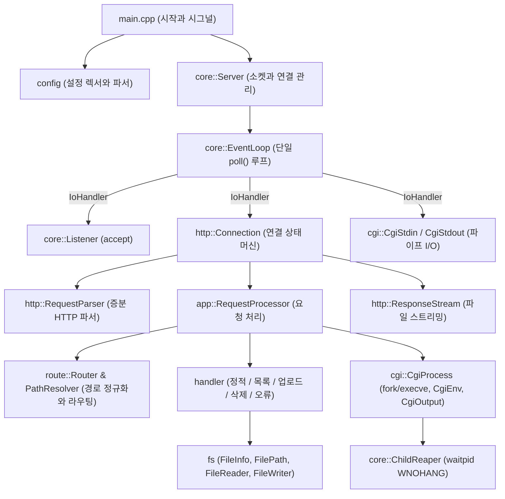
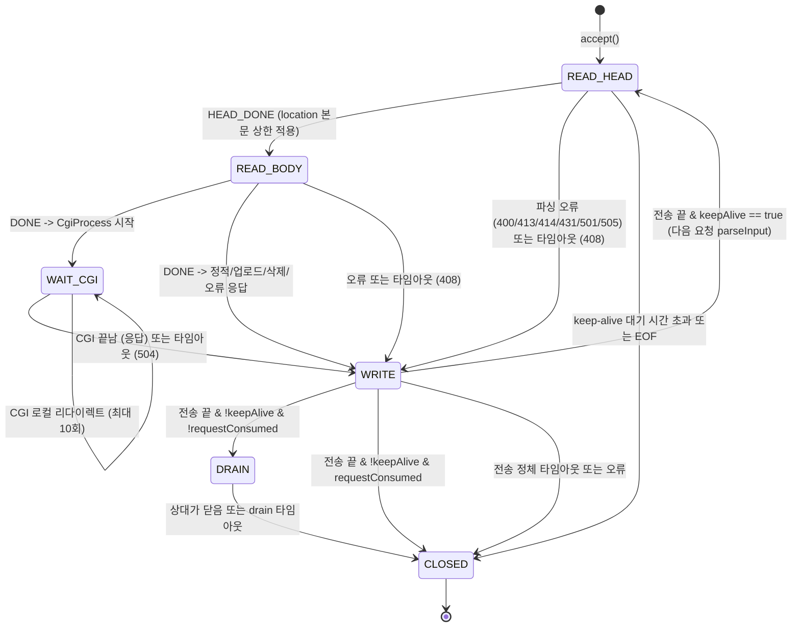

**한국어** | [English](architecture.en.md) · [README로 돌아가기](../README.md)

# 아키텍처와 설계 메모

`webserv`가 내부에서 어떻게 돌아가는지, 그리고 구현하면서 왜 이런 구조를 택했는지 정리한 문서다.

---

## 1. 모듈 구성

코드는 `include/`와 `src/` 아래 8개 디렉터리로 나뉜다. 의존성은 아래쪽 기본 모듈(`core`, `fs`, `http`)로만 향하게 잡았다.

| 디렉터리 | 하는 일 |
| :--- | :--- |
| `core/` | `poll()` 루프, 리스닝 소켓, `.webserv_clock` 시계, 시그널 처리, 자식 회수, 로그 기록 |
| `config/` | 설정 파일 토크나이저, 문법 검사, 지시어 규칙 표(`DirectiveRules`), 서버/로케이션 빌드 |
| `http/` | 연결 상태 머신, 증분 요청 파서, 응답 스트림, `multipart/form-data` 파서, MIME 타입 |
| `route/` | 경로 정규화, 루트 탈출(`..`) 차단, 최장 접두사 기반 로케이션 매칭 |
| `handler/` | 정적 파일, 디렉터리 목록(`autoindex`), 업로드, 삭제(`DELETE`), 상태 페이지 |
| `cgi/` | CGI 메타변수 구성, 헤더 필터링, 논블로킹 파이프 읽기/쓰기, CGI 출력 파싱 |
| `fs/` | 파일 상태 확인, 경로 붙이기, 제한 크기를 지키는 파일 읽기/쓰기 |
| `app/` | 파싱된 요청을 라우터와 핸들러/CGI로 넘기고, 공통 헤더(`Date`, `Connection`)를 붙임 |

---

## 2. 단일 `poll()` 루프와 안전한 핸들러 제거

`EventLoop`(`include/core/EventLoop.hpp`, `src/core/EventLoop.cpp`)는 리스닝 소켓, 클라이언트 소켓, CGI 파이프를 전부 한 스레드에서 하나의 `poll()`로 본다. `poll()` 타임아웃은 `1000 ms`다.

### `dispatch()` 중에 바로 지우지 않고 `unwatched_`에 모으는 이유
`onEvent()` 콜백이 실행되는 중에 연결이 끊기거나 CGI 파이프가 끝나서 `unwatch()`가 불릴 수 있다. 만약 `dispatch()`가 `handlers_` 벡터를 돌고 있는데 그 자리에서 원소를 빼면 반복자가 깨진다. 같은 회차에서 이미 지워진 핸들러를 참조할 위험도 있다.

그래서 순서를 이렇게 나눴다.
1. `dispatch()`는 시작할 때 `handlers_`를 `polled`로 복사해 두고 `dispatching_ = true`를 켠다.
2. 콜백 안에서 `unwatch(handler)`가 불리면 `unwatched_` 집합에 넣어 두기만 한다. 이번 회차에서 해당 핸들러의 남은 이벤트는 건너뛴다.
3. `dispatch()`가 끝난 뒤에야 `dropUnwatched()`가 `handlers_`에서 실제로 뺀다. 닫힌 `Connection`을 `delete`하는 것도 `dispatch()` 바깥인 `Server::afterIteration()`에서 한다.

### 예외 격리와 FD 고갈 처리
* **연결 단위 예외 격리:** `EventLoop::dispatch()`와 `Server::afterIteration()`은 `std::exception`이 튀어도 서버 전체를 죽이지 않고 해당 핸들러의 `onFailure()`만 호출해 그 연결만 닫는다.
* **FD가 꽉 찼을 때 스핀 막기:** FD 테이블이 꽉 차서 `accept()`가 실패하면 `Listener`는 폴링을 잠깐 멈춘다(`Server::acceptFailed`). 안 그러면 매 루프마다 `accept()` 실패가 반복되면서 CPU를 100% 쓰게 된다. 연결이 하나 닫히거나 1초가 지나면 `Server::afterIteration()`이 `resume()`으로 다시 연다.

---

## 3. 연결 상태 머신과 타임아웃

클라이언트 소켓 하나마다 `http::Connection` 객체 하나가 붙는다. 준비 이벤트가 오면 `recv()`나 `send()`를 딱 한 번만 한다.

### `DRAIN` 상태가 왜 필요한가 (RFC 9112 §9.6)
요청 본문이 큰데 `413` 같은 오류를 돌려주고 소켓을 바로 닫으면 문제가 생길 수 있다. 커널 수신 버퍼에 아직 안 읽은 바이트가 남아 있으면 OS가 TCP `RST`를 보낸다. 그러면 클라이언트가 서버의 오류 응답을 다 읽기도 전에 연결이 끊어질 수 있다. 그래서 요청을 다 못 읽은 상태에서 닫을 때는 `DRAIN`으로 넘어가 잠깐(`유휴 1초`, `전체 5초`) 남은 바이트를 읽어서 버린 다음 닫는다.

### 상한과 타임아웃 값 (`include/core/Limits.hpp`, `include/config/ConfigLimits.hpp`)

| 상수 | 값 | 용도 |
| :--- | :--- | :--- |
| `kPollTimeoutMs` | `1000 ms` | 타임아웃 검사를 돌리기 위한 `poll()` 대기 시간 |
| `kKeepAliveTimeoutSeconds` | `15 s` | 새 연결이나 keep-alive 상태에서 첫 바이트 기다리는 시간 (넘으면 응답 없이 닫음) |
| `kHeaderTimeoutSeconds` | `30 s` | 첫 바이트가 온 뒤 요청 헤더가 다 올 때까지 주는 총 시간 |
| `kBodyTimeoutSeconds` | `30 s` | 본문을 읽는 중 아무 데이터도 안 올 때 기다리는 시간 |
| `kSendTimeoutSeconds` | `30 s` | 응답을 보내는 중 진행 없이 기다리는 시간 |
| `kDrainIdleSeconds` / `Total` | `1 s` / `5 s` | 닫기 전에 남은 입력을 버릴 때 쓰는 유휴/전체 시간 |
| `kCgiTimeoutSeconds` | `10 s` | CGI 스크립트 하나에 주는 실행 시간 (넘으면 `504`) |
| `kMaxRequestLine` / `kMaxHeaderBytes` | `8 KiB` / `16 KiB` | 요청 줄(`414`)과 헤더+트레일러(`431`) 크기 상한 |
| `kInMemoryFileLimit` / `kFileChunkSize` | `1 MiB` / `64 KiB` | 메모리로 읽을 파일 크기 상한과 스트리밍할 때 한 번에 읽는 크기 |
| `kMaxCgiOutputBytes` | `16 MiB` | 메모리에 모으는 CGI 출력 상한 (넘으면 `502`) |
| `kMaxUploadFiles` | `5` | 업로드 요청 한 번에 저장할 수 있는 최대 파일 수 (넘으면 `413`) |
| `kDefaultMaxBodySize` / `Ceiling` | `1 MiB` / `100 MiB` | `client_max_body_size` 기본값과 설정 가능한 최대값 |

---

## 4. 증분 HTTP/1.1 파서

`RequestParser`(`include/http/RequestParser.hpp`)는 데이터가 몇 조각으로 쪼개져 들어오든 이어서 파싱한다.

1. **한 번만 버퍼 지우기 (`consumed_`):** 파싱하는 동안 앞부분을 매번 `erase`하지 않고 읽은 위치(`consumed_`)만 옮긴다. `feed()`가 끝날 때 한 번에 잘라낸다. 뒤따라온 파이프라인 요청은 버퍼에 그대로 남는다.
2. **2단계 본문 상한 (`HEAD_DONE`):** 헤더가 끝나기 전에는 `maxBodySize_`가 `0`이다. 헤더 파싱이 끝나 `HEAD_DONE`이 나오면, `Connection`이 `Router::locationFor()`로 해당 경로의 `client_max_body_size`를 찾아서 넣어 준 뒤 본문을 읽는다.
3. **본문 길이와 트레일러:** `Content-Length`는 오버플로우를 막으면서 읽고, `Transfer-Encoding: chunked`는 트레일러 줄까지 파싱한다. 트레일러 바이트 수도 헤더 바이트(`kMaxHeaderBytes`)에 함께 더해서 계산한다.

---

## 5. 비동기 CGI/1.1과 보안 처리

`CgiProcess`(`include/cgi/CgiProcess.hpp`, `src/cgi/CgiEnv.cpp`)는 CGI 스크립트가 실행되는 동안 이벤트 루프가 멈추지 않게 만든 모듈이다.

* **파이프 다중화:** `CgiStdin`과 `CgiStdout`이 `IoHandler`를 구현해서 `EventLoop`에 등록된다. 자식 프로세스는 `dup2`로 표준입출력을 파이프에 잇고, 상속된 다른 fd를 모두 닫은 뒤 스크립트가 있는 디렉터리로 이동(`chdir`)해서 `execve()`를 부른다.
* **출력 복사 줄이기:** 모은 CGI 출력(최대 `16 MiB`)은 `takeOutput()`에서 `std::string::swap`으로 넘긴다. C++98에서도 불필요한 버퍼 복사가 안 일어나게 하려는 의도다.
* **좀비 프로세스 회수 (`ChildReaper`):** 출력이 끝났거나 타임아웃(`SIGKILL`)으로 죽인 자식 PID는 `ChildReaper`가 넘겨받는다. 매 루프 반복마다 `waitpid(pid, ..., WNOHANG)`으로 멈추지 않고 회수한다.
* **보안 처리:**
  * `CgiEnv`에서 `Proxy` 헤더를 빼서 `HTTP_PROXY`가 환경변수로 넘어가는 `httpoxy`(`CVE-2016-5385`)를 막는다.
  * 이름에 `_`가 들어간 요청 헤더는 NGINX처럼 무시한다. `X_FOO`와 `X-Foo`가 둘 다 `HTTP_X_FOO`로 바뀌어 충돌하는 문제를 막기 위해서다.
  * `PathResolver`는 퍼센트 인코딩을 한 번만 풀고 `.`/`..`을 정리한다. 루트(`/`) 위로 올라가려는 요청은 `400 Bad Request`로 끊고, `alias` 경로도 세그먼트 경계가 맞을 때만 매칭한다.

---

## 6. 시간 함수 없이 시계 구현하기 (`.webserv_clock`)

* **제약:** 42 `webserv` 과제에서는 `time()`, `gettimeofday()`, `clock_gettime()` 같은 시간 함수를 쓸 수 없다.
* **해결 방법 (`Clock`):** `EventLoop`가 한 바퀴 돌 때마다 `.webserv_clock`이라는 작은 파일을 다시 쓰고, 허용 함수인 `stat()`으로 수정 시각(`st_mtime`)을 읽는다.
* **쓰임:** 이렇게 얻은 초 단위 시각을 연결 타임아웃, CGI 타임아웃, `Date` 헤더 생성에 쓴다. `Clock` 클래스 안에 가둬 두어서 테스트할 때도 다루기 쉽다.
