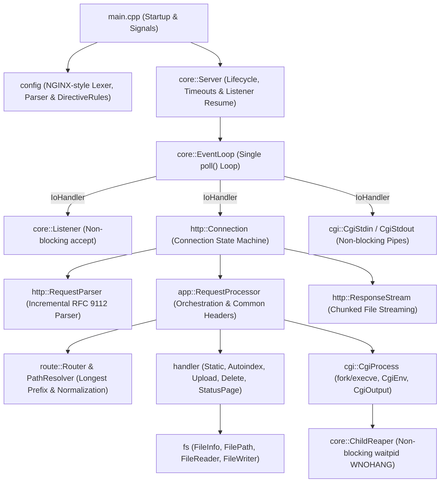
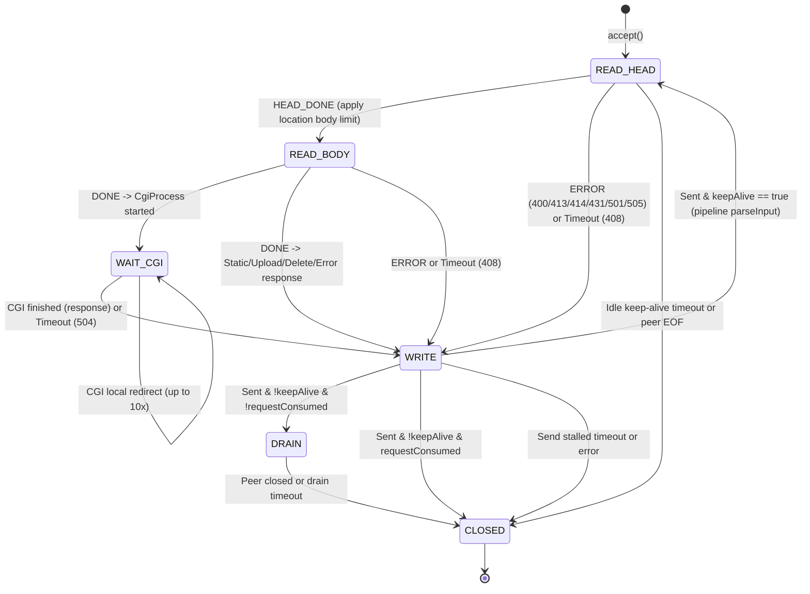

# Architecture & Engineering Decisions / 아키텍처 및 설계 의사결정

> Detailed technical reference for **webserv** — written for both **backend (HTTP/1.1 & CGI/1.1)** and **systems/network (non-blocking `poll()`, POSIX IPC, resource isolation)** engineering reviews.
>
> **webserv**의 상세 기술 문서입니다. **백엔드(HTTP/1.1, CGI/1.1)** 및 **시스템·네트워크(논블로킹 `poll()`, POSIX IPC, 리소스 격리)** 직무 관점 모두에서 설계 근거를 확인할 수 있도록 정리했습니다.

---

## 1. Layered Module Architecture / 계층형 모듈 아키텍처

The codebase is organized into 8 cohesive layers under `include/` and `src/` with unidirectional dependencies toward `core/` and `http/` primitives.
코드베이스는 `include/`와 `src/` 아래 **8개의 응집도 높은 계층**으로 분리되어 있으며, 의존성은 하위 인프라(`core`, `fs`, `http`) 방향으로만 흐릅니다.

| Layer | Directory | Responsibility (EN) | 역할 (KR) |
| :--- | :--- | :--- | :--- |
| **Core** | `core/` | Single `poll()` loop, listening sockets, `stat()`-based clock, signal flags, child reaper, logger | 단일 `poll()` 이벤트 루프, 리스너, 파일 `mtime` 기반 시계, 시그널, 좀비 회수, 로거 |
| **Config** | `config/` | Lexer, syntax parser, table-driven `DirectiveRules`, server/location builders | 렉서, 구문 파서, 테이블 기반 지시어 검증(`DirectiveRules`), 설정 빌더 |
| **HTTP** | `http/` | Connection FSM, incremental RFC 9112 parser, response streaming, multipart parser, MIME | 연결 상태 머신, 증분 HTTP/1.1 파서, 스트리밍 응답, `multipart/form-data` 파서 |
| **Route** | `route/` | RFC 3986 path normalization, traversal rejection, longest-prefix location matching | 경로 정규화, 루트 탈출 차단(`400`), 최장 접두사(Longest-prefix) 라우팅 |
| **Handler** | `handler/` | Static files, directory listing (`autoindex`), multipart upload, `DELETE`, error pages | 정적 파일, 디렉토리 목록, 파일 업로드(`201`/`409`), 삭제(`204`), 상태 페이지 |
| **CGI** | `cgi/` | RFC 3875 meta-variables, `httpoxy` filtering, non-blocking pipe I/O, CGI header parsing | CGI/1.1 환경변수, 보안 헤더 필터링, 논블로킹 파이프 I/O, CGI 출력 파싱 |
| **FS** | `fs/` | Safe filesystem primitives (`FileInfo`, `FilePath`, bounded whole-file reads/writes) | 파일 메타데이터 조회, 경로 조합, 상한 제한 파일 읽기/쓰기 추상화 |
| **App** | `app/` | Connects HTTP requests to routing, handlers, CGI launch, and common headers (`Date`) | 요청을 라우팅·핸들러·CGI와 연결하고 공통 응답 헤더(`Date`, `Connection`) 부여 |

---

## 2. Single `poll()` Event Loop & Reentrancy Safety / 단일 `poll()` 루프와 재진입 안전성

`EventLoop` (`include/core/EventLoop.hpp`, `src/core/EventLoop.cpp`) drives **every file descriptor**—listening sockets, accepted client sockets, and CGI stdin/stdout pipes—within one OS thread and one `poll()` call (`limits::kPollTimeoutMs = 1000 ms`).

`EventLoop`는 리스닝 소켓, 클라이언트 소켓, CGI 파이프를 **단일 프로세스·단일 `poll()` 호출**로 다중화합니다.

### Why Deferred Removal (`unwatched_` + `dropUnwatched()`) Matters / 지연 제거 설계 이유
* **EN:** An `IoHandler::onEvent()` callback may close a connection or finish a CGI pipe, calling `EventLoop::unwatch()` while `EventLoop::dispatch()` is still iterating over `polled` handlers. Deleting or erasing from `handlers_` mid-loop would invalidate iterators or cause use-after-free on subsequent events in the same round.
* **KR:** `EventLoop::dispatch()`가 이벤트 목록을 순회하는 도중 `onEvent()`가 `unwatch()`를 호출할 수 있습니다. 이때 `handlers_` 벡터를 즉시 수정하면 반복자가 무효화되거나 같은 회차의 남은 이벤트 처리 중 해제된 객체에 접근(Use-After-Free)할 위험이 있습니다.
* **Solution / 해결:**
  1. `dispatch()` snapshots `handlers_` into `polled` and sets `dispatching_ = true`.
  2. `unwatch(handler)` inserts the pointer into `unwatched_` and skips remaining events for that handler in the current round.
  3. After `dispatch()` completes, `dropUnwatched()` removes marked handlers safely, and `Server::afterIteration()` deletes closed connections outside event dispatch.

### Fault Isolation & FD Exhaustion Backpressure / 장애 격리와 FD 고갈 역압 제어
* **Per-connection Exception Isolation (`EventLoop::dispatch` & `Server::afterIteration`):** If `std::bad_alloc` or `std::exception` escapes a single handler or timeout check, only that handler's `onFailure()` is invoked to close that connection—keeping the rest of the server alive.
* **Listener Pause/Resume (`Server::acceptFailed`):** When `accept()` fails (e.g., process file descriptor table full, `EMFILE`), `Listener` pauses `POLLIN` polling instead of busy-spinning at 100% CPU on every `poll()` iteration, and `Server::afterIteration()` resumes listeners once a connection closes or 1 second elapses.

---

## 3. Connection State Machine & Timeouts / 연결 상태 머신 및 타임아웃

Each client socket is owned by `http::Connection` (`include/http/Connection.hpp`, `src/http/Connection.cpp`), performing **at most one `recv()` or `send()` per readiness event**.

각 클라이언트 소켓은 `http::Connection`이 소유하며, `poll()` 준비 이벤트당 **최대 한 번의 `recv()` 또는 `send()`**만 수행합니다.

### Why `DRAIN` Exists (RFC 9112 §9.6) / `DRAIN` 상태를 둔 이유
* **EN:** When the server rejects a request early (e.g., `413 Payload Too Large` or `408`) and closes the socket immediately while unread body bytes or pipelined requests remain in the kernel receive buffer, the OS sends a TCP `RST` that can wipe out the error response before the client reads it. Transitioning to `DRAIN` reads and discards incoming bytes briefly (`kDrainIdleSeconds = 1s`, `kDrainTotalSeconds = 5s`) before closing cleanly.
* **KR:** 요청 본문을 다 읽기 전에 오류 응답(`413` 등)을 보내고 소켓을 즉시 닫으면, 수신 버퍼에 남은 데이터 때문에 커널이 TCP `RST`를 전송하여 클라이언트가 오류 응답을 받기 전에 연결이 끊어질 수 있습니다. `DRAIN` 상태는 짧은 시간 동안 잔여 바이트를 읽어 비운 뒤 정상 종료하여 응답 유실을 방지합니다.

### Timeout & Resource Limits (`include/core/Limits.hpp`, `include/config/ConfigLimits.hpp`)

| Constant | Value | Purpose (EN) | 목적 (KR) |
| :--- | :--- | :--- | :--- |
| `kPollTimeoutMs` | `1000 ms` | `poll()` wake-up interval for timeout checks | 타임아웃 검사를 위한 `poll()` 주기 |
| `kKeepAliveTimeoutSeconds` | `15 s` | Idle wait before first byte (silent close) | Keep-Alive 유휴 대기 (초과 시 무응답 종료) |
| `kHeaderTimeoutSeconds` | `30 s` | Total time allowed for request head from first byte | 첫 바이트부터 헤더 완료까지 총 제한 시간 (Slowloris 방지) |
| `kBodyTimeoutSeconds` | `30 s` | Idle time allowed between body chunks | 요청 본문 수신 중 무진행 허용 시간 |
| `kSendTimeoutSeconds` | `30 s` | Idle time allowed without `send()` progress | 응답 전송 중 무진행 허용 시간 |
| `kDrainIdleSeconds` / `Total` | `1 s` / `5 s` | Draining unread request bytes before close | 연결 종료 전 잔여 입력 폐기 시간 |
| `kCgiTimeoutSeconds` | `10 s` | Maximum execution time per CGI script (`504`) | CGI 스크립트 최대 실행 시간 (`504`) |
| `kMaxRequestLine` / `kMaxHeaderBytes` | `8 KiB` / `16 KiB` | Bounds request line (`414`) & headers+trailers (`431`) | 요청 줄(`414`) 및 헤더+트레일러(`431`) 크기 상한 |
| `kInMemoryFileLimit` / `kFileChunkSize` | `1 MiB` / `64 KiB` | Threshold & chunk size for streaming static files | 대용량 정적 파일 스트리밍 임계치 및 청크 크기 |
| `kMaxCgiOutputBytes` | `16 MiB` | Cap on buffered CGI output (`502` if exceeded) | CGI 출력 메모리 상한 (초과 시 `502`) |
| `kMaxUploadFiles` | `5` | Max files per multipart upload (`413` if exceeded) | 단일 업로드 요청당 최대 파일 수 (루프 블로킹 방지) |
| `kDefaultMaxBodySize` / `Ceiling` | `1 MiB` / `100 MiB` | Default and max configurable `client_max_body_size` | 기본/최대 설정 가능 요청 본문 크기 상한 |

---

## 4. Incremental HTTP/1.1 Parser & Body Limit Handshake / 증분 HTTP/1.1 파서

`RequestParser` (`include/http/RequestParser.hpp`) handles arbitrary TCP segmentation and HTTP pipelining:

1. **Cursor-based Consumption (`consumed_`):** Consumes bytes from `inBuffer_` and erases them once at the end of `feed()`, avoiding repeated `std::string::erase` shifts. Unread pipelined bytes remain intact for the next request.
2. **Two-phase Body Limit (`HEAD_DONE`):** Until headers finish, `maxBodySize_` is `0`. Upon `HEAD_DONE`, `Connection` queries `RequestProcessor::bodyLimitFor()` via `Router::locationFor()` to apply the exact `client_max_body_size` of the matched location before parsing the body.
3. **Framing & Security:** Supports `Content-Length` (with overflow guards) and `Transfer-Encoding: chunked` including trailers (counted against `kMaxHeaderBytes` to prevent header-limit bypass).

---

## 5. Asynchronous CGI/1.1 & Security Hardening / 비동기 CGI/1.1 및 보안 강화

`CgiProcess` (`include/cgi/CgiProcess.hpp`, `src/cgi/CgiEnv.cpp`) runs CGI scripts without blocking the event loop:

* **Non-blocking Pipe Multiplexing:** Creates input (`CgiStdin`) and output (`CgiStdout`) pipes registered on `EventLoop` as `IoHandler` instances. Child `runChild()` redirects stdin/stdout via `dup2`, closes inherited descriptors, `chdir()`s into the script's directory, and calls `execve()`.
* **Zero-copy Output Handoff:** Collected output (up to `16 MiB`) is returned via `std::string::swap` in `takeOutput()` so C++98 NRVO avoids multi-megabyte buffer copies.
* **Zombie Process Prevention (`ChildReaper`):** Finished or timed-out (`SIGKILL`) CGI PIDs are adopted by `ChildReaper` and collected non-blockingly via `waitpid(pid, ..., WNOHANG)` on every iteration.
* **Security Mitigations in `CgiEnv.cpp`:**
  * **CVE-2016-5385 (`httpoxy`):** Strips the `Proxy` request header so `HTTP_PROXY` is never injected into CGI environments.
  * **Header Spoofing Prevention:** Drops request header names containing underscores (`_`), matching NGINX default behavior so `X_FOO` cannot collide with `HTTP_X_FOO` from `X-Foo`.
  * **Path Traversal Blocking (`PathResolver`):** Decodes percent-encoding once, resolves `.` / `..`, rejects attempts to escape above root with `400 Bad Request`, and enforces segment-boundary matching on `alias` locations.

---

## 6. Solving Constraints Without Allowed Time Functions / 제약 극복: `.webserv_clock`

* **Constraint / 제약:** The 42 `webserv` subject forbids standard C/POSIX time functions (`time()`, `gettimeofday()`, `clock_gettime()`).
* **Implementation (`core::Clock`):** On every `EventLoop` iteration, `Clock::refresh()` rewrites a small sentinel file (`.webserv_clock`) and reads its modification timestamp (`st_mtime`) via `stat()` (an allowed system call).
* **Usage / 활용:** Feeds both per-state connection/CGI timeouts and RFC 9110 `Date` header generation (`HttpDate`), isolating time acquisition behind a single testable class (`clock_test.cpp`).
