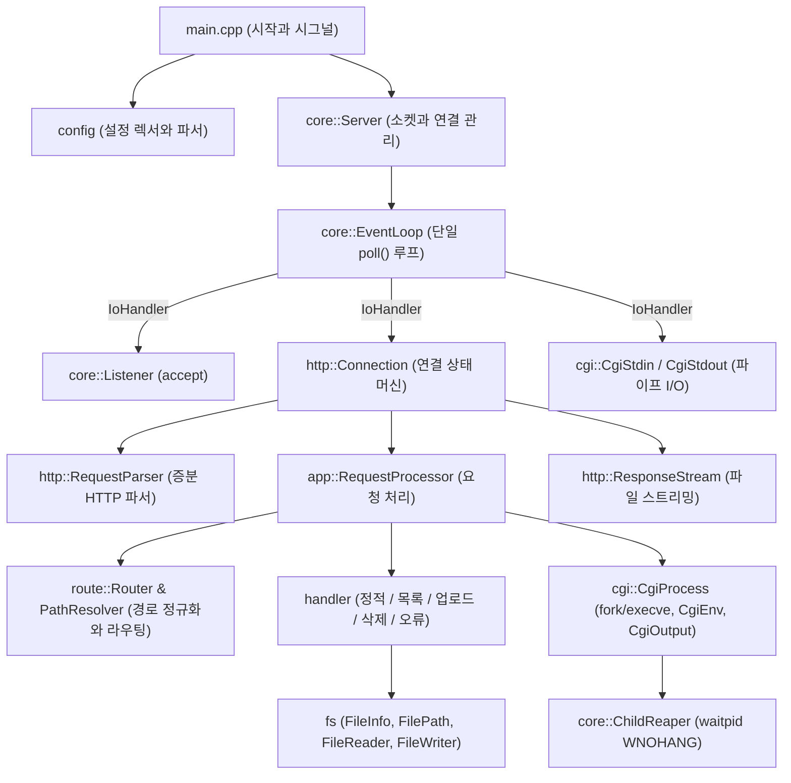
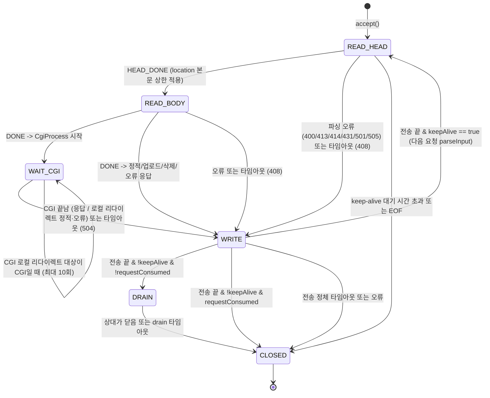

**한국어** | [English](architecture.en.md) · [README로 돌아가기](../README.md)

# 아키텍처와 설계 메모

`webserv`의 내부 구조와 구현하면서 내린 설계 결정을 정리했다.

---

## 1. 모듈 구성

코드는 `include/`와 `src/` 아래 8개 디렉터리로 나뉜다. 상위 계층이 하위 인프라(`core`, `fs`, `http`)에만 의존하도록 방향을 잡았다.

| 디렉터리 | 담당 역할 |
| :--- | :--- |
| `core/` | `poll()` 루프, 리스닝 소켓, `.webserv_clock` 시계, 시그널 플래그, 자식 회수, 로그 기록 |
| `config/` | 설정 파일 토크나이저, 구문 검사, 지시어 규칙 표(`DirectiveRules`), 서버/로케이션 빌드 |
| `http/` | 연결 상태 머신, 증분 요청 파서, 응답 스트림, `multipart/form-data` 파서, MIME 타입 |
| `route/` | 경로 정규화, 루트 탈출(`..`) 차단, 최장 접두사 기반 로케이션 매칭 |
| `handler/` | 정적 파일, 디렉터리 목록(`autoindex`), 업로드, 삭제(`DELETE`), 상태 페이지 |
| `cgi/` | CGI 메타변수 구성, 헤더 필터링, 논블로킹 파이프 I/O, CGI 출력 파싱 |
| `fs/` | 파일 상태 확인, 경로 조합, 상한을 지키는 파일 읽기/쓰기 |
| `app/` | 파싱된 요청을 라우터와 핸들러/CGI로 연결하고 공통 헤더(`Date`, `Connection`) 부여 |

---

## 2. 단일 `poll()` 루프와 지연 제거

`EventLoop`(`include/core/EventLoop.hpp`, `src/core/EventLoop.cpp`)는 리스닝 소켓, 클라이언트 소켓, CGI 파이프를 모두 한 스레드에서 하나의 `poll()`로 감시한다. 타임아웃은 `1000 ms`다.

### `dispatch()` 중 바로 지우지 않고 `unwatched_`에 모으는 이유

`onEvent()` 콜백이 도는 동안 연결이 끊기거나 CGI 파이프가 끝나서 `unwatch()`가 호출될 수 있다. `handlers_` 벡터를 순회하던 중에 원소를 바로 지우면 반복자가 깨진다. 같은 회차에서 이미 해제된 핸들러를 다시 호출할 위험도 있다.

그래서 순서를 두 단계로 나눴다.

1. `dispatch()`는 시작 시 `handlers_`를 `polled`로 복사해 두고 `dispatching_ = true`를 켠다.
2. 콜백 안에서 `unwatch(handler)`가 불리면 `unwatched_` 집합에 표시만 해 두고, 이번 회차에서 그 핸들러의 남은 이벤트는 건너뛴다.
3. `dispatch()`가 끝난 뒤 `dropUnwatched()`가 표시된 핸들러를 실제로 제거한다. 닫힌 `Connection` 객체의 `delete`도 `dispatch()` 바깥인 `Server::afterIteration()`에서 처리한다.

### 예외 격리와 FD 고갈 처리

`EventLoop::dispatch()`와 `Server::afterIteration()`은 `std::exception`이 발생해도 서버 전체를 멈추지 않고 해당 핸들러의 `onFailure()`만 호출해 그 연결만 닫는다.

파일 디스크립터 테이블이 꽉 차서 `accept()`가 실패할 때도 주의가 필요하다. 그대로 두면 매 루프마다 `accept()`가 실패하면서 CPU를 100% 쓰게 된다. 그래서 `Server::acceptFailed()`가 호출되면 `Listener`의 `POLLIN` 감시를 잠깐 멈추고, 연결이 닫히거나 1초가 지난 뒤 `Server::afterIteration()`에서 `resume()`으로 다시 연다.

---

## 3. 연결 상태 머신과 타임아웃

클라이언트 소켓 하나마다 `http::Connection` 객체 하나가 붙는다. 준비 이벤트가 올 때마다 `recv()`나 `send()`를 한 번만 실행한다.

### `DRAIN` 상태가 필요한 이유 (RFC 9112 §9.6)

요청 본문이 큰데 `413` 같은 오류를 돌려주고 소켓을 곧장 닫으면 문제가 생긴다. 커널 수신 버퍼에 아직 읽지 않은 바이트가 남아 있으면 OS가 TCP `RST`를 보낸다. 그러면 클라이언트가 서버의 오류 응답을 다 읽기도 전에 연결이 끊어질 수 있다. 요청을 다 읽지 못한 채 닫아야 할 때는 `DRAIN` 상태로 넘겨 짧은 시간(`유휴 1초`, `전체 5초`) 동안 남은 입력을 읽어 버린 뒤 닫는다.

### 상한과 타임아웃 값 (`include/core/Limits.hpp`, `include/config/ConfigLimits.hpp`)

| 상수 | 값 | 용도 |
| :--- | :--- | :--- |
| `kPollTimeoutMs` | `1000 ms` | 타임아웃 검사를 돌리기 위한 `poll()` 대기 시간 |
| `kKeepAliveTimeoutSeconds` | `15 s` | 새 연결이나 keep-alive 상태에서 첫 바이트 기다리는 시간 (초과 시 무응답 종료) |
| `kHeaderTimeoutSeconds` | `30 s` | 첫 바이트가 온 뒤 요청 헤더가 다 올 때까지 주는 총 시간 |
| `kBodyTimeoutSeconds` | `30 s` | 본문을 읽는 중 아무 데이터도 안 올 때 기다리는 시간 |
| `kSendTimeoutSeconds` | `30 s` | 응답을 보내는 중 진행 없이 기다리는 시간 |
| `kDrainIdleSeconds` / `Total` | `1 s` / `5 s` | 닫기 전에 남은 입력을 버릴 때 쓰는 유휴/전체 시간 |
| `kCgiTimeoutSeconds` | `10 s` | CGI 스크립트 하나에 주는 실행 시간 (초과 시 `504`) |
| `kMaxRequestLine` / `kMaxHeaderBytes` | `8 KiB` / `16 KiB` | 요청 줄(`414`)과 헤더+트레일러(`431`) 크기 상한 |
| `kInMemoryFileLimit` / `kFileChunkSize` | `1 MiB` / `64 KiB` | 메모리로 읽을 파일 크기 상한과 스트리밍 청크 크기 |
| `kMaxCgiOutputBytes` | `16 MiB` | 메모리에 모으는 CGI 출력 상한 (초과 시 `502`) |
| `kMaxUploadFiles` | `5` | 업로드 요청 한 번에 저장할 수 있는 최대 파일 수 (초과 시 `413`) |
| `kDefaultMaxBodySize` / `Ceiling` | `1 MiB` / `100 MiB` | `client_max_body_size` 기본값과 설정 가능한 최대값 |

---

## 4. 증분 HTTP/1.1 파서

`RequestParser`(`include/http/RequestParser.hpp`)는 TCP 패킷이 몇 조각으로 쪼개져 오든 상태를 유지하며 파싱한다.

파싱하는 동안에는 매번 버퍼 앞부분을 `erase`하지 않고 읽은 위치(`consumed_`)만 옮긴다. `feed()`가 끝날 때 한 번만 앞부분을 잘라내며, 파이프라인으로 뒤따라 들어온 다음 요청 바이트는 버퍼에 그대로 남겨 둔다.

본문 크기 제한은 2단계로 적용한다. 헤더 파싱이 끝나기 전에는 `maxBodySize_`를 `0`으로 두었다가, `HEAD_DONE`이 반환되면 `Connection`이 `Router::locationFor()`로 해당 경로의 `client_max_body_size`를 조회해 넣은 뒤 본문을 읽는다. `Content-Length`는 정수 오버플로우를 검사하면서 읽고, `Transfer-Encoding: chunked`의 트레일러 바이트 수도 `kMaxHeaderBytes`에 합산해 헤더 제한 우회를 막는다.

---

## 5. 비동기 CGI/1.1과 보안 처리

`CgiProcess`(`include/cgi/CgiProcess.hpp`, `src/cgi/CgiEnv.cpp`)는 CGI 스크립트가 실행되는 동안 이벤트 루프가 멈추지 않게 파이프로 통신한다.

`CgiStdin`과 `CgiStdout`이 `IoHandler`를 구현해 `EventLoop`에 등록된다. 자식 프로세스는 `dup2`로 표준입출력을 파이프에 연결하고, `F_SETFD`(`FD_CLOEXEC`)가 허용 함수에 없어 `/dev/fd`를 `opendir()`/`readdir()`로 읽어 `3`(`STDERR_FILENO + 1`) 이상의 열린 디스크립터를 모두 닫는다. 그 뒤 스크립트가 있는 디렉터리로 이동(`chdir`)하고 `SIGPIPE`를 기본 동작(`SIG_DFL`)으로 되돌린 다음 `execve()`를 실행한다. 모은 CGI 출력(최대 `16 MiB`)은 `takeOutput()`에서 `std::string::swap`으로 넘겨 C++98 환경에서도 불필요한 대용량 복사가 일어나지 않게 했다.

출력 수집이 끝났거나 타임아웃(`SIGKILL`)으로 중단된 자식 PID는 `ChildReaper`가 넘겨받아 매 루프마다 `waitpid(pid, ..., WNOHANG)`으로 회수한다.

보안 측면에서는 세 가지를 막았다.

* `CgiEnv`에서 `Proxy` 헤더를 빼서 `HTTP_PROXY` 환경변수 주입(`httpoxy`, `CVE-2016-5385`)을 차단한다.
* 이름에 `_`가 들어간 요청 헤더는 NGINX 기본 설정처럼 무시해 `X_FOO`와 `X-Foo`가 `HTTP_X_FOO`로 충돌하지 않게 한다.
* `PathResolver`는 퍼센트 인코딩을 한 번만 풀고 `.`/`..`을 정리한 뒤 루트(`/`) 위로 올라가는 경로는 `400 Bad Request`로 거부한다. `alias` 경로도 세그먼트 경계가 맞을 때만 매칭한다.

---

## 6. 시간 함수 없이 시계 구현하기 (`.webserv_clock`)

42 `webserv` 과제에서는 `time()`, `gettimeofday()`, `clock_gettime()` 같은 시간 함수를 쓸 수 없다.

그래서 `Clock` 클래스는 `EventLoop`가 한 바퀴 돌 때마다 `.webserv_clock`이라는 작은 파일을 다시 쓰고, 허용 시스템 콜인 `stat()`으로 수정 시각(`st_mtime`)을 읽어 초 단위 현재 시각을 얻는다. 연결 타임아웃, CGI 타임아웃, `Date` 헤더 생성이 모두 이 클래스 하나만 보도록 분리해 두어서 단위 테스트(`clock_test.cpp`)로 검증하기도 편하다.
