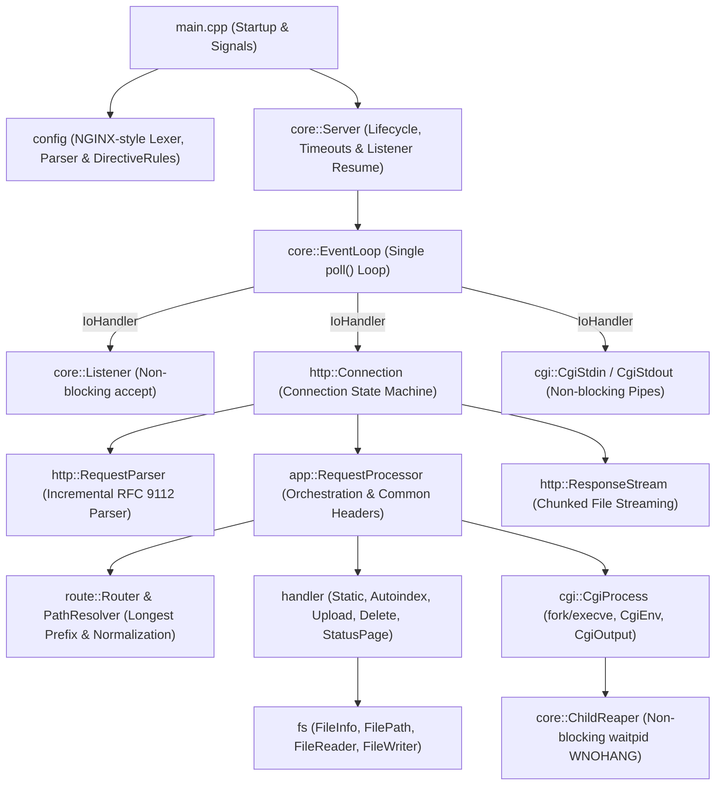
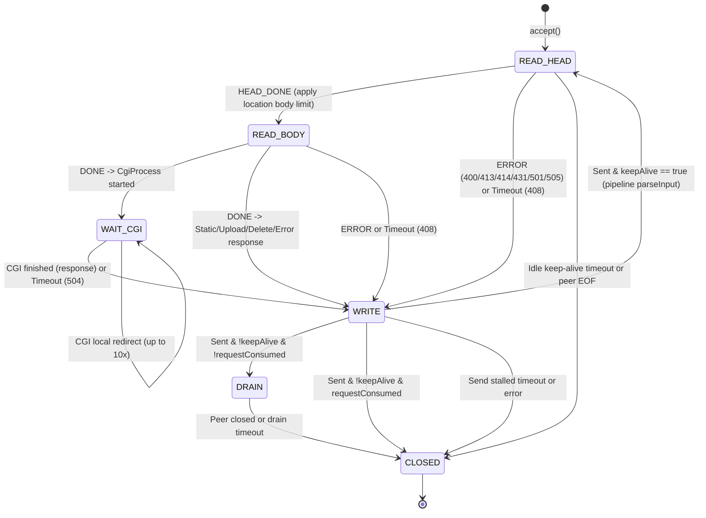

**English** | [한국어](architecture.ko.md) · [Back to README](../README.md)

# Architecture & Engineering Decisions

> Detailed technical reference for **webserv** — written for both **backend (HTTP/1.1 & CGI/1.1)** and **systems/network (non-blocking `poll()`, POSIX IPC, resource isolation)** engineering reviews.

---

## 1. Layered Module Architecture

The codebase is organized into 8 cohesive layers under `include/` and `src/` with unidirectional dependencies toward `core/` and `http/` primitives.

| Layer | Directory | Responsibility |
| :--- | :--- | :--- |
| **Core** | `core/` | Single `poll()` loop, listening sockets, `stat()`-based clock, signal flags, child reaper, logger |
| **Config** | `config/` | Lexer, syntax parser, table-driven `DirectiveRules`, server/location builders |
| **HTTP** | `http/` | Connection FSM, incremental RFC 9112 parser, response streaming, multipart parser, MIME |
| **Route** | `route/` | RFC 3986 path normalization, traversal rejection, longest-prefix location matching |
| **Handler** | `handler/` | Static files, directory listing (`autoindex`), multipart upload, `DELETE`, error pages |
| **CGI** | `cgi/` | RFC 3875 meta-variables, `httpoxy` filtering, non-blocking pipe I/O, CGI header parsing |
| **FS** | `fs/` | Safe filesystem primitives (`FileInfo`, `FilePath`, bounded whole-file reads/writes) |
| **App** | `app/` | Connects HTTP requests to routing, handlers, CGI launch, and common headers (`Date`) |

---

## 2. Single `poll()` Event Loop & Reentrancy Safety

`EventLoop` (`include/core/EventLoop.hpp`, `src/core/EventLoop.cpp`) drives **every file descriptor**—listening sockets, accepted client sockets, and CGI stdin/stdout pipes—within one OS thread and one `poll()` call (`limits::kPollTimeoutMs = 1000 ms`).

### Why Deferred Removal (`unwatched_` + `dropUnwatched()`) Matters
An `IoHandler::onEvent()` callback may close a connection or finish a CGI pipe, calling `EventLoop::unwatch()` while `EventLoop::dispatch()` is still iterating over `polled` handlers. Erasing from `handlers_` mid-loop would invalidate iterators or cause use-after-free on subsequent events in the same round.

1. `dispatch()` snapshots `handlers_` into `polled` and sets `dispatching_ = true`.
2. `unwatch(handler)` inserts the pointer into `unwatched_` and skips remaining events for that handler in the current round.
3. After `dispatch()` completes, `dropUnwatched()` removes marked handlers safely, and `Server::afterIteration()` deletes closed connections outside event dispatch.

### Fault Isolation & FD Exhaustion Backpressure
* **Per-connection Exception Isolation (`EventLoop::dispatch` & `Server::afterIteration`):** If `std::bad_alloc` or `std::exception` escapes a single handler or timeout check, only that handler's `onFailure()` is invoked to close that connection—keeping the rest of the server alive.
* **Listener Pause/Resume (`Server::acceptFailed`):** When `accept()` fails (e.g., process file descriptor table full, `EMFILE`), `Listener` pauses `POLLIN` polling instead of busy-spinning at 100% CPU on every `poll()` iteration, and `Server::afterIteration()` resumes listeners once a connection closes or 1 second elapses.

---

## 3. Connection State Machine & Timeouts

Each client socket is owned by `http::Connection` (`include/http/Connection.hpp`, `src/http/Connection.cpp`), performing **at most one `recv()` or `send()` per readiness event**.

### Why `DRAIN` Exists (RFC 9112 §9.6)
When the server rejects a request early (e.g., `413 Payload Too Large` or `408`) and closes the socket immediately while unread body bytes or pipelined requests remain in the kernel receive buffer, the OS sends a TCP `RST` that can wipe out the error response before the client reads it. Transitioning to `DRAIN` reads and discards incoming bytes briefly (`kDrainIdleSeconds = 1s`, `kDrainTotalSeconds = 5s`) before closing cleanly.

### Timeout & Resource Limits (`include/core/Limits.hpp`, `include/config/ConfigLimits.hpp`)

| Constant | Value | Purpose |
| :--- | :--- | :--- |
| `kPollTimeoutMs` | `1000 ms` | `poll()` wake-up interval for timeout checks |
| `kKeepAliveTimeoutSeconds` | `15 s` | Idle wait before first byte (silent close) |
| `kHeaderTimeoutSeconds` | `30 s` | Total time allowed for request head from first byte (Slowloris defense) |
| `kBodyTimeoutSeconds` | `30 s` | Idle time allowed between body chunks |
| `kSendTimeoutSeconds` | `30 s` | Idle time allowed without `send()` progress |
| `kDrainIdleSeconds` / `Total` | `1 s` / `5 s` | Draining unread request bytes before close |
| `kCgiTimeoutSeconds` | `10 s` | Maximum execution time per CGI script (`504`) |
| `kMaxRequestLine` / `kMaxHeaderBytes` | `8 KiB` / `16 KiB` | Bounds request line (`414`) & headers+trailers (`431`) |
| `kInMemoryFileLimit` / `kFileChunkSize` | `1 MiB` / `64 KiB` | Threshold & chunk size for streaming static files |
| `kMaxCgiOutputBytes` | `16 MiB` | Cap on buffered CGI output (`502` if exceeded) |
| `kMaxUploadFiles` | `5` | Max files per multipart upload (`413` if exceeded) |
| `kDefaultMaxBodySize` / `Ceiling` | `1 MiB` / `100 MiB` | Default and max configurable `client_max_body_size` |

---

## 4. Incremental HTTP/1.1 Parser & Body Limit Handshake

`RequestParser` (`include/http/RequestParser.hpp`) handles arbitrary TCP segmentation and HTTP pipelining:

1. **Cursor-based Consumption (`consumed_`):** Consumes bytes from `inBuffer_` and erases them once at the end of `feed()`, avoiding repeated `std::string::erase` shifts. Unread pipelined bytes remain intact for the next request.
2. **Two-phase Body Limit (`HEAD_DONE`):** Until headers finish, `maxBodySize_` is `0`. Upon `HEAD_DONE`, `Connection` queries `RequestProcessor::bodyLimitFor()` via `Router::locationFor()` to apply the exact `client_max_body_size` of the matched location before parsing the body.
3. **Framing & Security:** Supports `Content-Length` (with overflow guards) and `Transfer-Encoding: chunked` including trailers (counted against `kMaxHeaderBytes` to prevent header-limit bypass).

---

## 5. Asynchronous CGI/1.1 & Security Hardening

`CgiProcess` (`include/cgi/CgiProcess.hpp`, `src/cgi/CgiEnv.cpp`) runs CGI scripts without blocking the event loop:

* **Non-blocking Pipe Multiplexing:** Creates input (`CgiStdin`) and output (`CgiStdout`) pipes registered on `EventLoop` as `IoHandler` instances. Child `runChild()` redirects stdin/stdout via `dup2`, closes inherited descriptors, `chdir()`s into the script's directory, and calls `execve()`.
* **Zero-copy Output Handoff:** Collected output (up to `16 MiB`) is returned via `std::string::swap` in `takeOutput()` so C++98 NRVO avoids multi-megabyte buffer copies.
* **Zombie Process Prevention (`ChildReaper`):** Finished or timed-out (`SIGKILL`) CGI PIDs are adopted by `ChildReaper` and collected non-blockingly via `waitpid(pid, ..., WNOHANG)` on every iteration.
* **Security Mitigations in `CgiEnv.cpp`:**
  * **CVE-2016-5385 (`httpoxy`):** Strips the `Proxy` request header so `HTTP_PROXY` is never injected into CGI environments.
  * **Header Spoofing Prevention:** Drops request header names containing underscores (`_`), matching NGINX default behavior so `X_FOO` cannot collide with `HTTP_X_FOO` from `X-Foo`.
  * **Path Traversal Blocking (`PathResolver`):** Decodes percent-encoding once, resolves `.` / `..`, rejects attempts to escape above root with `400 Bad Request`, and enforces segment-boundary matching on `alias` locations.

---

## 6. Solving Constraints Without Allowed Time Functions

* **Constraint:** The 42 `webserv` subject forbids standard C/POSIX time functions (`time()`, `gettimeofday()`, `clock_gettime()`).
* **Implementation (`core::Clock`):** On every `EventLoop` iteration, `Clock::refresh()` rewrites a small sentinel file (`.webserv_clock`) and reads its modification timestamp (`st_mtime`) via `stat()` (an allowed system call).
* **Usage:** Feeds both per-state connection/CGI timeouts and RFC 9110 `Date` header generation (`HttpDate`), isolating time acquisition behind a single testable class (`clock_test.cpp`).
